# ClickHouse — Lightning Fast Analytics for Everyone — подробное саммари

**Robert Schulze, Tom Schreiber, Ilya Yatsishin, Ryadh Dahimene, Alexey Milovidov. ClickHouse Inc.**

**Публикация:** PVLDB, 17(12), 3731–3744, 2024. DOI: [10.14778/3685800.3685802](https://doi.org/10.14778/3685800.3685802).

**Оригинал:** [локальный PDF](./clickhouse-vldb2024.pdf), [PDF на сайте VLDB](https://www.vldb.org/pvldb/vol17/p3731-schulze.pdf). 14 страниц; SHA-256: `006157c7e5f0651b4fe3818b8f834265f7394ff349813ad53879ccc4b75e8a04`.

Саммари следует структуре оригинала: сохранены все нумерованные разделы и подразделы, Abstract, Acknowledgments и References. Темы, выделенные авторами внутри подразделов, обозначены жирным текстом. Рисунки взяты из оригинала; рядом разобрано их содержание. Версии, ограничения и планы развития ниже относятся ко времени написания статьи, прежде всего к ClickHouse 24.6, а не автоматически к сегодняшнему состоянию системы.

---

## ABSTRACT

Объёмы хранимых и анализируемых данных растут, а бизнес использует их для улучшения продуктов, оценки работы и принятия решений. При масштабах интернета мало просто сохранить историю: нужно экономично обслуживать одновременно исторические данные, быстро поступающие новые записи и большое число аналитических запросов. Для интерактивных сценариев ожидается задержка порядка секунды или меньше, хотя конкретный порог зависит от приложения.

Статья представляет архитектуру **ClickHouse**, открытой OLAP-СУБД для высокопроизводительной аналитики над петабайтами данных при высокой скорости загрузки. Слой хранения сочетает идеи LSM-деревьев с фоновым преобразованием истории: агрегацией, переносом на другие носители и другими действиями. SQL-запросы обрабатывает векторизованный движок с возможностью компиляции отдельных вычислений. Значительная часть ускорения достигается за счёт **data pruning**: система старается вообще не читать и не обрабатывать данные, которые не могут повлиять на ответ.

Внешние системы подключаются на уровне табличных функций, движков таблиц и движков баз данных. Приведённые измерения позволяют авторам отнести ClickHouse к самым быстрым аналитическим СУБД среди рассмотренных систем. Последующие разделы показывают, на каких нагрузках и с какими оговорками получен этот результат.

## 1. INTRODUCTION

ClickHouse проектируется для аналитических запросов к таблицам с триллионами строк и сотнями колонок. Разработка началась в 2009 году с оператора фильтрации и агрегации веб-журналов; исходный код был открыт в 2016 году.

Авторы формулируют **пять основных требований** к современной аналитической СУБД.

**1. Большие объёмы данных и высокая скорость поступления.** Веб-аналитика, финансы и электронная торговля постоянно порождают новые данные. Для их обработки нужны эффективные индексы, сжатие и распределение хранения между машинами: в принятой авторами модели один сервер обычно ограничен несколькими десятками терабайт. При этом свежие данные часто полезнее истории для принятия оперативных решений. Поэтому СУБД должна выдерживать и постоянный поток, и всплески вставок, одновременно «понижая приоритет» старых данных — например, агрегируя или архивируя их — и сохраняя возможность выполнять отчётные запросы.

**2. Много одновременных запросов с небольшими задержками.** Нагрузки включают разовые исследовательские запросы и повторяющиеся запросы дашбордов. Интерактивность требует хорошей оптимизации и исполнения. Повторяемость части нагрузки даёт возможность подстроить физическое размещение под часто используемые фильтры и отсекать лишние данные. Когда запросов много, нужны также правила совместного использования CPU, памяти, дисков и сети: равные доли ресурсов либо приоритет для более важных запросов.

**3. Разнообразные хранилища, местоположения и форматы.** Аналитическая СУБД должна встраиваться в уже существующую инфраструктуру и читать и записывать данные во внешних системах, в разных форматах и местах хранения. Открытость интеграции — самостоятельное требование к архитектуре.

**4. Удобный язык и средства исследования производительности.** Практическим пользователям нужен выразительный SQL-диалект, включая вложенные типы, обычные, агрегатные и оконные функции. Столь же важна возможность понять производительность отдельного запроса и всей системы: одной высокой скорости без объяснимых планов и наблюдаемости недостаточно.

**5. Надёжность и разные способы развёртывания.** Репликация должна защищать от отказов обычного оборудования. Система должна работать и на старом ноутбуке, и на мощном сервере. Нативный бинарный файл позволяет использовать возможности процессора, включая SIMD, и обходиться без накладных расходов сборщика мусора, характерных для JVM-приложений.

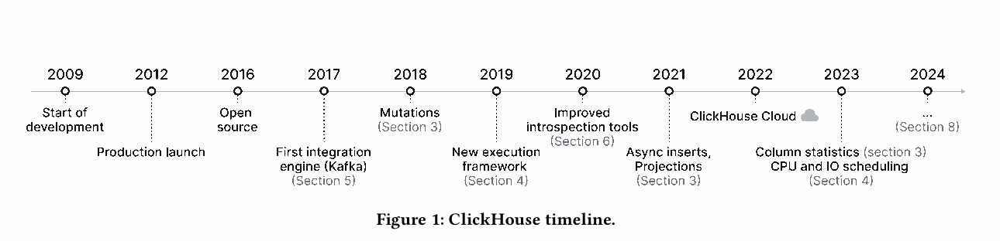

**Рисунок 1 — временная шкала.** Начало разработки — 2009; промышленный запуск — 2012; открытие исходного кода — 2016; первый интеграционный движок Kafka — 2017; mutations — 2018; новый framework исполнения — 2019; улучшенные инструменты анализа производительности — 2020; асинхронные вставки и projections — 2021; ClickHouse Cloud — 2022; статистика колонок, управление CPU и I/O — 2023. Для 2024 года рисунок отсылает к перспективам из §8. Эта последовательность показывает развитие системы от специализированной обработки журналов к более универсальной аналитической платформе.

## 2. ARCHITECTURE

Архитектура разделена на **слой обработки запросов**, **слой хранения** и **слой интеграции**. Дополнительный access layer обслуживает пользовательские сессии и протоколы связи. Общие для слоёв компоненты отвечают за потоки, кэши, RBAC, резервное копирование и непрерывный мониторинг. ClickHouse написан на C++ и поставляется одним статически скомпонованным бинарным файлом без внешних зависимостей.

Запрос проходит разбор, построение и оптимизацию логического и физического планов, затем исполнение. Векторизованная модель следует подходу MonetDB/X100; для отдельных вычислений используется компиляция. Помимо SQL, статья называет PRQL и Kusto Query Language, KQL, как языки входных запросов.

**Движки таблиц.** Движок скрывает конкретный формат и местоположение данных. Авторы выделяют три категории.

1. **Семейство `MergeTree*`** — основной формат постоянного хранения. Таблица состоит из отсортированных горизонтальных частей, которые фоновый процесс постепенно объединяет. Разные движки семейства определяют, что происходит со строками при слиянии: например, значения агрегируются либо устаревшие версии заменяются новыми.
2. **Специализированные движки** ускоряют или распределяют исполнение. Dictionaries предоставляют быстрый доступ по ключу к данным, которые периодически обновляются результатом запроса к внутреннему или внешнему источнику; это полезно, если допустима некоторая устарелость. Другие примеры — полностью оперативный движок для временных таблиц и `Distributed`, дающий общий доступ к шардам.
3. **Виртуальные движки** обеспечивают двусторонний обмен с внешними системами: PostgreSQL и MySQL, Kafka и RabbitMQ, Redis, озёрами данных Iceberg, DeltaLake и Hudi, объектными хранилищами вроде S3 и Google Cloud Storage.

**Шардирование и репликация.** Выражение шардирования распределяет строки между независимыми таблицами-шардами, обычно находящимися на разных узлах. Клиент может обращаться к шардам напрямую либо работать с общей таблицей `Distributed`. Шардирование позволяет превысить вместимость одного сервера и распределить нагрузку чтения и записи.

Шарды можно дополнительно реплицировать. У движков `MergeTree*` есть варианты `ReplicatedMergeTree*`, использующие multi-master-координацию через **ClickHouse Keeper**. Keeper написан на C++, совместим с интерфейсом ZooKeeper и реализует консенсус Raft. Он обеспечивает согласование реплик; подробнее протокол разобран в §3.6.

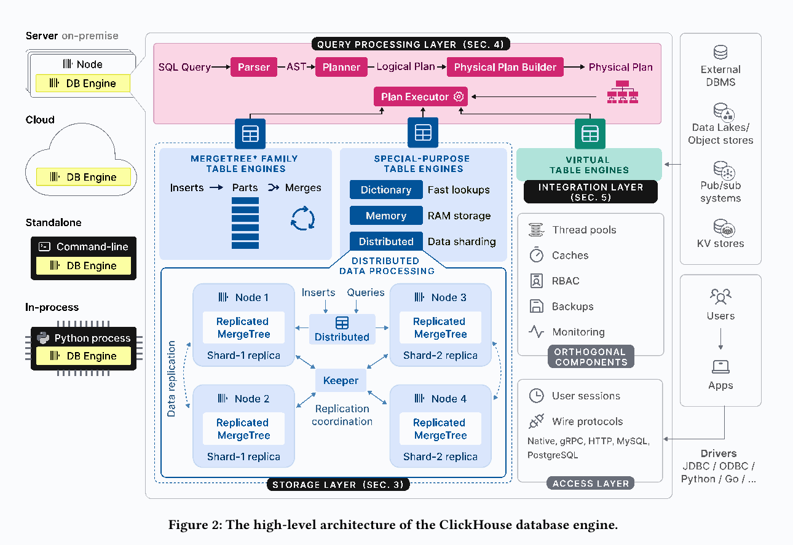

**Рисунок 2** связывает эти части в единую систему: SQL проходит Parser, Planner, Physical Plan Builder и Plan Executor; ниже находятся три категории движков и внешние источники. Пример кластера содержит два шарда, у каждого по две реплики. `Distributed` маршрутизирует запросы к шардам, Keeper координирует репликацию. Справа показаны общие службы и клиентские протоколы, включая native, gRPC, HTTP, MySQL и PostgreSQL, а также драйверы JDBC, ODBC, Python и Go. Слева — способы запуска одного и того же движка.

**Четыре режима использования.**

- **On-premise:** самостоятельный одиночный сервер либо кластер с шардированием и репликацией. Клиенты используют нативный, MySQL- и PostgreSQL-совместимые протоколы либо HTTP REST API.
- **Cloud:** управляемый сервис ClickHouse Cloud с автоматическим масштабированием. Статья сосредоточена на on-premise; отдельную архитектуру Cloud авторы намеревались описать в следующей публикации.
- **Standalone:** командная утилита для анализа и преобразования файлов средствами SQL, без предварительного развёртывания сервера. Этот режим ограничен одной машиной.
- **In-process:** `chDB` встраивает движок в процесс приложения, например для Jupyter и Pandas. Вдохновлённый DuckDB подход позволяет эффективно передавать входные данные и результаты внутри одного адресного пространства, избегая лишнего копирования между приложением и отдельным сервером.

## 3. STORAGE LAYER

Раздел посвящён основному формату хранения `MergeTree*`: организации файлов, отсечению данных, преобразованию истории во время слияний, обновлениям и удалениям, повторным вставкам, репликации и гарантиям конкурентного доступа.

### 3.1 On-Disk Format

Таблица состоит из набора **неизменяемых parts**. Вставка набора строк создаёт новую part. Внутри неё находятся и данные, и все метаданные для их интерпретации: читать part можно без дополнительного обращения к центральному каталогу.

Чтобы количество файлов и parts не росло бесконтрольно, фоновый процесс объединяет несколько небольших parts в более крупную, пока не достигнут заданный предел; в статье приведён размер **150 GB по умолчанию**. Поскольку строки в каждой part отсортированы по ключевым колонкам, применяется эффективное k-way merge sort. Исходные parts становятся неактивными, но физически удаляются только после того, как перестанут использоваться текущими запросами: их reference count должен стать нулевым.

**Режимы вставки.** В синхронном режиме каждый `INSERT` создаёт part. Для уменьшения стоимости последующих слияний рекомендуется пакетная вставка — в статье приведён пример с **20 000 строк** за запрос. Однако ожидание заполнения клиентского пакета может быть неприемлемым для свежих событий. Например, тысячи агентов мониторинга присылают маленькие порции метрик и журналов. В асинхронном режиме ClickHouse объединяет входящие вставки в серверном буфере одной таблицы, а part создаётся при достижении порога размера или тайм-аута.

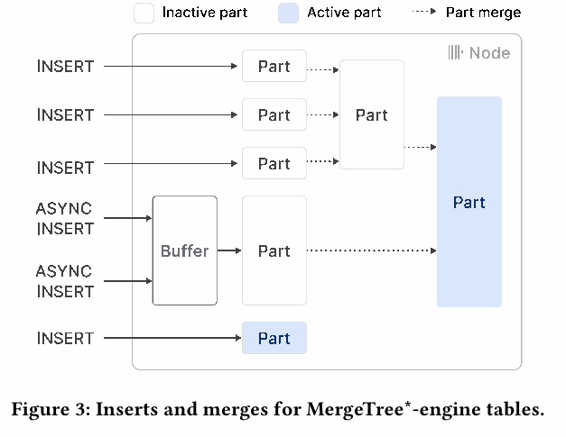

**Рисунок 3:** четыре синхронные вставки и две асинхронные дают пять первоначальных parts, поскольку асинхронные порции попадают в общий буфер. Два слияния сокращают число активных parts до двух. Неактивные исходные файлы некоторое время сосуществуют с результатами слияний.

**Связь с LSM.** В отличие от уровневой организации традиционных LSM-хранилищ, parts в ClickHouse равноправны; слияние не ограничено одним уровнем. Вместе с этим исчезает неявный хронологический порядок уровней, поэтому для обновлений и удалений используются механизмы из §3.4. Вставки записываются прямо в файлы parts, тогда как типичная LSM-система сначала использует write-ahead log.

**Колонки, гранулы и блоки.** Обычная part — каталог с отдельными файлами колонок. Для маленьких parts, в статье **меньше 10 MB по умолчанию**, колонки последовательно размещаются в одном файле: это улучшает пространственную локальность чтения и записи.

Строки логически разбиваются на **гранулы**; статья использует размер **8192 строки**. Гранула — минимальная неделимая единица, с которой работают сканирование и поиск по индексу. Но дисковое чтение и запись организованы **сжатыми блоками колонок**, объединяющими соседние гранулы. Целевой размер блока, в статье **1 MB по умолчанию**, задаётся в байтах. Поэтому число гранул в блоке зависит от типа и распределения значений соответствующей колонки.

При загрузке в память блок распаковывается. Чтобы быстро найти гранулу в сжатых данных, для каждой колонки хранится отображение из номера гранулы в две координаты: смещение её сжатого блока в файле и смещение самой гранулы внутри распакованного блока. Логическая точность отсечения гранул и объём физически прочитанных сжатых данных поэтому связаны, но не совпадают автоматически.

**Сжатие и кодирование.** По умолчанию применяется LZ4. Доступны специализированные кодеки, например Gorilla и FPC для чисел с плавающей точкой. Кодеки можно соединять в цепочки: сначала убрать закономерность чисел delta coding, затем сжать результат общим алгоритмом, затем применить AES-кодек для шифрования. Цель — уменьшить хранимый объём и стоимость I/O.

Два wrapper-типа меняют внутреннее представление колонки: `LowCardinality(T)` заменяет повторяющиеся значения целочисленными идентификаторами словаря, а `Nullable(T)` добавляет bitmap, обозначающий `NULL`. Первый особенно полезен при небольшом числе различных значений; второй хранит признак отсутствия отдельно от основного значения.

**Партиции и статистика.** Авторы перечисляют range-, hash- и round-robin-партиционирование, задаваемое выражениями. Для отсечения партиций хранятся минимумы и максимумы значений выражения партиционирования. Дополнительно пользователь может создавать статистики колонок; статья называет HyperLogLog и t-digest, в том числе для получения оценок кардинальности и распределения данных.

### 3.2 Data Pruning

Последовательное чтение петабайт ради одного ответа слишком дорого. ClickHouse использует три основных механизма, позволяющих заранее исключать значительную часть строк: **разреженный первичный индекс, projections и skipping indices**.

**Первичный индекс.** Ключ определяет локальную сортировку строк внутри каждой part. Для первой строки каждой гранулы сохраняется соответствие между значениями ключа и номером гранулы. Индекс **разреженный**, поскольку запись создаётся на гранулу, а не на каждую строку. Приблизительно **1000 индексных записей достаточно для 8,1 млн строк**, поэтому структура обычно целиком помещается в оперативную память.

Главное назначение — ускорить равенства и диапазоны по часто фильтруемым колонкам: вместо полного чтения нужные диапазоны гранул ищутся по отсортированному индексу. Локальный порядок также используется при слияниях и оптимизации запросов: например, для агрегации по упорядоченным значениям и устранения отдельной сортировки, если требуемый запросом порядок совместим с порядком хранения. Подробности проверки условий — в §4.4.

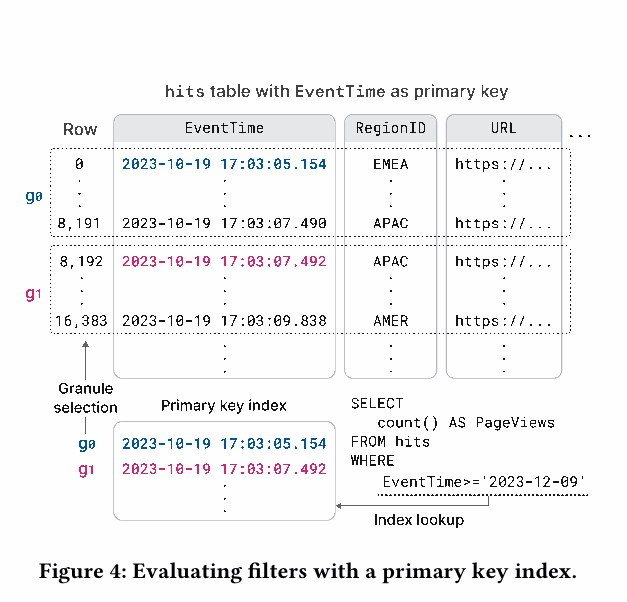

**Рисунок 4:** таблица просмотров страниц упорядочена по `EventTime`. Для гранул `g0` и `g1` показаны первые строки с номерами 0 и 8192 и соответствующие записи индекса. По граничным временам определяется, какие гранулы могут пересекаться с диапазоном фильтра; сами значения `EventTime` во всей таблице ради этого предварительного решения сканировать не требуется. Окончательное условие всё равно применяется к прочитанным строкам выбранных гранул.

**Projections.** Это альтернативные физические представления тех же строк с другим ключом сортировки. Они позволяют ускорять фильтры, плохо согласованные с ключом основной таблицы. Цена — дополнительные место, работа при вставках и слияниях. По умолчанию projection появляется для новых parts; существующие части нужно материализовать отдельно. Оптимизатор выбирает чтение основной таблицы или projection по оценке I/O. Если для конкретной part projection ещё нет, запрос читает соответствующую основную part, поэтому неполное покрытие не делает данные недоступными.

**Skipping indices.** Вместо полноценной дополнительной копии строк хранится небольшое описание нескольких последовательных гранул. Пользователь задаёт выражение индекса и его гранулярность — число гранул в одном индексном блоке. Если описание доказывает, что условие внутри блока не выполнится, строки можно пропустить.

- **Min-max:** минимальное и максимальное значения выражения. Хорошо работает, когда соседние строки близки по значению и локальный диапазон мал, например при приблизительной упорядоченности данных.
- **Set:** ограниченный набор различных значений блока. Подходит для небольшой **локальной** кардинальности, когда одинаковые значения собраны рядом.
- **Bloom filter:** компактная проверка присутствия значений с настраиваемой вероятностью ложного срабатывания; применима к значениям строк, токенам и n-граммам, в том числе для текстового поиска. В описании статьи этот тип не используется для диапазонных и отрицательных предикатов, в отличие от некоторых возможностей min-max и set. Ложное срабатывание увеличивает чтение, поскольку блок приходится проверить, но само по себе не означает ошибочный ответ запроса.

Ключевой общий принцип: важна согласованность **фильтра с распределением значений внутри гранул и блоков**. Высокая доля отфильтрованных строк ещё не гарантирует эффективного отсечения, если подходящие строки рассеяны по всему физическому представлению.

### 3.3 Merge-time Data Transformation

В BI и observability данные поступают непрерывно или всплесками, а наиболее полезной для оперативного анализа обычно оказывается свежая часть. Историю нужно постепенно сокращать, агрегировать и переносить. ClickHouse выполняет такие преобразования **инкрементально во время фоновых слияний**, отделяя обслуживание истории от обработки новых вставок. Авторы подчёркивают, что такой путь предназначен для преобразования истории без ухудшения производительности `INSERT`; это архитектурная цель описанного подхода, а не отдельное измерение нулевой стоимости фоновой работы.

Отложенность имеет следствие: до соответствующего слияния в таблице могут оставаться устаревшие версии и ещё не объединённые агрегаты. Статья указывает `SELECT ... FINAL` как средство применения merge-семантики во время чтения. Для практического использования нужно учитывать семантику конкретного движка: это утверждение нельзя превращать в обещание немедленного выполнения любого фонового действия, например перемещения по TTL.

**Replacing merges.** Строки с одинаковым ключом считаются версиями одного объекта. Обычно сохраняется наиболее поздно вставленная версия, определяемая по времени создания part; остальные удаляются при слиянии. Для явного управления можно задать колонку версии. Подход используют для частых обновлений через вставку новой версии либо для дедупликации во время слияния как альтернативы механизму при вставке из §3.5.

**Aggregating merges.** Строки с одинаковыми значениями ключа объединяются в строку с **частичными состояниями агрегатов**. Например, для среднего хранятся сумма и количество, а объединение двух состояний складывает обе компоненты. Это позволяет корректно агрегировать уже агрегированные данные, не вычисляя «среднее средних» без весов.

Основное применение — **материализованные представления**. В ClickHouse они обновляются инкрементально при вставке новой part в исходную таблицу: transformation query обрабатывает поступившие данные и записывает результат в представление. Полного периодического пересчёта всего источника, характерного для некоторых других СУБД, описанный подход не требует.

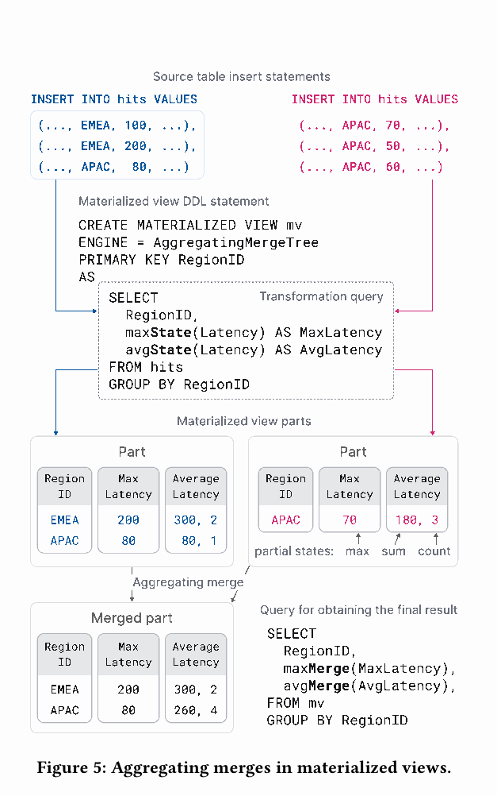

**Рисунок 5** показывает `AggregatingMergeTree` с группировкой по `RegionID`. Запрос преобразования использует `maxState(Latency)` и `avgState(Latency)`. Для EMEA значения 100 и 200 дают максимум 200 и состояние среднего `(300, 2)`. Для APAC первая вставка даёт 80, вторая — 70, 50 и 60. После слияния APAC получает максимум 80 и состояние `(260, 4)`. Окончательное чтение использует `maxMerge` и `avgMerge`: для EMEA среднее равно 150, для APAC — 65. Суффикс `-State` создаёт состояние, `-Merge` объединяет состояния и возвращает итоговый агрегат. Обычные фоновые слияния сокращают число этих состояний, а финальный запрос должен корректно объединять и ещё не слитые parts.

**TTL merges.** Механизм старения данных обрабатывает одну part за раз. Правило состоит из выражения-триггера, вычисляющего время для строки, и действия. При слиянии полученное время сравнивается с текущим. Хотя триггер позволяет описывать условия на уровне строк, авторы отмечают практическую достаточность проверки, что условие выполнено для **всех строк part**, после чего действие применяется ко всей части.

Перечислены четыре действия: перенести part на другой volume, например более дешёвый и медленный; пересжать более тяжёлым кодеком; удалить; выполнить roll-up — укрупнить данные группировкой и агрегатами. Таким образом, сохранённая история может постепенно становиться менее подробной и более дешёвой.

**Listing 1 — пример переноса в S3 спустя неделю:**

```sql
CREATE TABLE tab (ts DateTime, msg String)
ENGINE MergeTree PRIMARY KEY ts
TTL (ts + INTERVAL 1 WEEK) TO VOLUME 's3';
```

В контексте описанного переноса part перемещается, когда значения времени во всей part достаточно старые. Задача примера — показать управляемое старение истории без отдельной прикладной программы, переписывающей таблицу.

### 3.4 Updates and Deletes

`MergeTree*` оптимизирован под добавление данных, но отдельные исправления и удаления всё же нужны, например по требованиям регулирования. Авторы описывают два механизма, которые допускают параллельные вставки.

**Mutations** в описании статьи последовательно переписывают parts таблицы. Для удаления затрагиваются все колонки, для обновления — изменяемые. Чтобы временно не удваивать всю таблицу при удалении или всю колонку при обновлении, преобразование выполняется неатомарно на уровне всей таблицы: параллельный `SELECT` может увидеть сочетание уже обработанных и ещё не обработанных parts. После завершения mutation данные физически изменены. Тяжёлое удаление дорого из-за переписывания колонок parts.

**Lightweight deletes** изменяют внутреннюю bitmap-колонку с признаком удаления. В `SELECT` добавляется фильтр, исключающий помеченные строки. Физически они исчезнут при одном из будущих обычных слияний; конкретный момент заранее не гарантирован. Чем шире таблица, тем существеннее возможная экономия при удалении одной bitmap вместо всех колонок. Цена переносится на чтение: каждый запрос дополнительно учитывает признак удаления.

Обновления и удаления в одной таблице предполагаются редкими и сериализованными, чтобы не возникало логических конфликтов. Это ограничение важно для понимания целевой append-only-нагрузки.

### 3.5 Idempotent Inserts

После тайм-аута соединения клиент не знает, успел ли сервер сохранить отправленный пакет. Простая повторная отправка может создать дубликаты. Традиционное решение — уникальные ограничения и быстрые точечные проверки по индексам на деревьях, radix trees или хеш-таблицах. Однако индексирование **каждой строки** слишком дорого по памяти и стоимости обновления для огромных таблиц и интенсивного потока вставок.

ClickHouse использует более дешёвую **дедупликацию пакетов/parts**. Сервер хранит хеши последних `N` вставленных parts; в статье пример — `N = 100`. Если повторная вставка имеет уже известный хеш, она игнорируется. Для нереплицируемой таблицы эта информация хранится локально, для реплицируемой — в Keeper.

Клиент может повторить тот же пакет после сетевого сбоя, полагаясь на серверное распознавание повторения **в пределах сохраняемой истории дедупликации**. Для дополнительного контроля можно передать собственный insert token вместо автоматически вычисленного идентификатора. Хеширование новых строк требует работы, но хранение и сравнение небольшого числа хешей даёт, по оценке авторов, пренебрежимо малые дополнительные расходы. Описанная гарантия относится к повторению вставок и не предполагает бессрочного хранения идентификаторов всех когда-либо записанных строк.

### 3.6 Data Replication

Репликация нужна для доступности при отказах, распределения нагрузки и обновления узлов без остановки сервиса. **Состояние таблицы** задаётся набором parts и метаданными, включая названия и типы колонок. Состояние меняют три категории операций:

1. Вставка добавляет новую part.
2. Слияние добавляет результат и убирает исходные parts.
3. Mutations и DDL добавляют или удаляют parts и/или изменяют метаданные в зависимости от конкретной команды.

Операция сначала выполняется локально на одном узле, затем переход состояния регистрируется в **общем журнале репликации**. Обычно журнал обслуживают три процесса Keeper, согласующие его через Raft. В исходном согласованном состоянии узлы указывают на одну позицию журнала. Остальные узлы асинхронно воспроизводят новые записи и догоняют состояние.

Такая репликация даёт **eventual consistency**: разные реплики временно могут отвечать из разных состояний. Для большинства описанных операций возможен синхронный режим, в котором завершения ждут до применения изменения к заданному кворуму — например, большинству или всем узлам. Выбор режима меняет требуемое подтверждение операции.

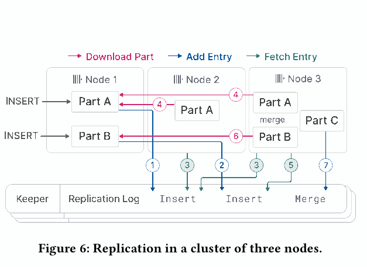

**Рисунок 6:** Node 1 получает две вставки и добавляет две записи в Keeper. Node 2 читает первую запись и скачивает соответствующую part с Node 1. Node 3 получает обе записи и обе parts. Затем Node 3 сливает их, заменяет исходные parts результатом и публикует новую запись о слиянии. Важная деталь: Keeper координирует изменения через журнал, а сами файлы parts передаются между узлами хранения.

**Три оптимизации синхронизации:**

- Новый узел может скопировать актуальное состояние узла, записавшего последнюю запись, вместо восстановления всей истории от начала. В соответствующем предложении оригинала есть противоречивое сочетание «воспроизводить с начала» и «вместо этого скопировать состояние»; описанное назначение оптимизации и второе действие указывают именно на обход полного replay.
- Слияние можно повторить локально либо скачать уже готовый результат с другой реплики. Настройка позволяет обменивать затраты CPU на сетевой I/O; между дата-центрами часто выгоднее локальное слияние, уменьшающее стоимость передачи.
- Независимые записи журнала можно применять параллельно: например, скачивать parts последовательных независимых вставок или выполнять независимые операции над разными таблицами.

### 3.7 ACID Compliance

Для высокой конкурентной производительности ClickHouse по возможности избегает кратковременных внутренних блокировок, latches. В начале запроса фиксируется **снимок набора parts всех задействованных таблиц**. Parts, появившиеся после этого из вставок или слияний, в данный запрос не попадают. Для читаемых parts увеличивается reference count, поэтому их файлы нельзя удалить, пока запрос их использует.

Авторы описывают это как **snapshot isolation**, реализованную вариантом MVCC на версиях parts. При этом они прямо ограничивают гарантию: в общем случае statements не являются полностью ACID-совместимыми; в тексте выделено редкое исключение, когда параллельные записи при снятии снимка затрагивают по одной part. Поэтому из неизменяемости отдельной part и согласованности её чтения нельзя вывести полную транзакционность произвольной группы изменений.

Ещё одно осознанное решение касается сохранности последних вставок при аварийном отключении питания. По умолчанию ClickHouse не требует `fsync` каждой новой part, позволяя ядру ОС объединять записи. Авторы мотивируют это тем, что многие интенсивно записывающие аналитические сценарии допускают небольшой риск потери самых свежих данных ради пропускной способности. В оригинале этот компромисс назван отказом от *atomicity*; описанный риск потери подтверждённых данных при отключении питания относится также к **durability**, и эти гарантии при практическом использовании нужно проверять отдельно.

## 4. QUERY PROCESSING LAYER

ClickHouse использует три уровня параллелизма: **элементы данных внутри SIMD-инструкций**, **чанки данных между потоками одного узла** и **шарды между узлами**. Векторизованная модель передаёт между операторами сразу группы строк, сокращая число виртуальных вызовов по сравнению с обработкой по одной строке.

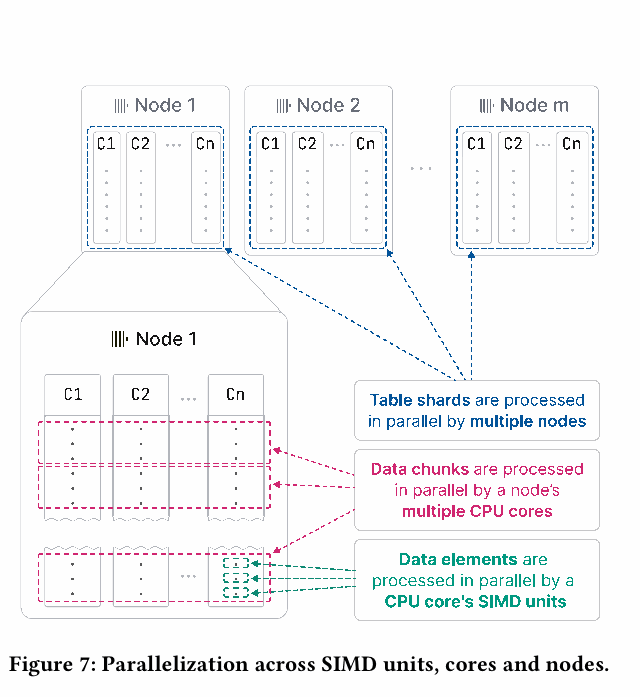

**Рисунок 7** последовательно приближает устройство выполнения: независимые шарды читаются разными машинами; части данных одного шарда — разными CPU cores; элементы внутри чанка — SIMD units одного ядра. Добавление узлов даёт горизонтальное масштабирование, добавление ядер — вертикальное. Остальная часть раздела разбирает эти уровни, оптимизации и совместное использование ресурсов несколькими запросами.

### 4.1 SIMD Parallelization

Передача нескольких строк за раз позволяет векторизовать вычисления вручную через intrinsics либо автоматически компилятором. Для горячего цикла оператора могут быть собраны несколько **compute kernels**: скалярный, автоматически векторизованный AVX2 и вручную векторизованный AVX-512.

Во время запуска выбирается подходящее ядро вычислений по возможностям CPU, определяемым `cpuid`. Это сочетает поддержку старых машин с ускорением на новых: в описанной авторами сборке минимальным требованием служит **SSE 4.2**, что на момент статьи позволяло работать примерно на пятнадцатилетних системах.

### 4.2 Multi-Core Parallelization

SQL преобразуется в ориентированный граф физических операторов. **Source operators** читают нативный либо сторонний формат, **sink operator** преобразует ответ в нужный выходной формат. При построении исполнения граф разворачивается в независимые **execution lanes** с учётом размера источника и максимального числа worker threads, по умолчанию равного числу ядер. Каждая lane обрабатывает непересекающийся диапазон входа; объединять lanes стараются как можно позже, чтобы дольше сохранять параллелизм.

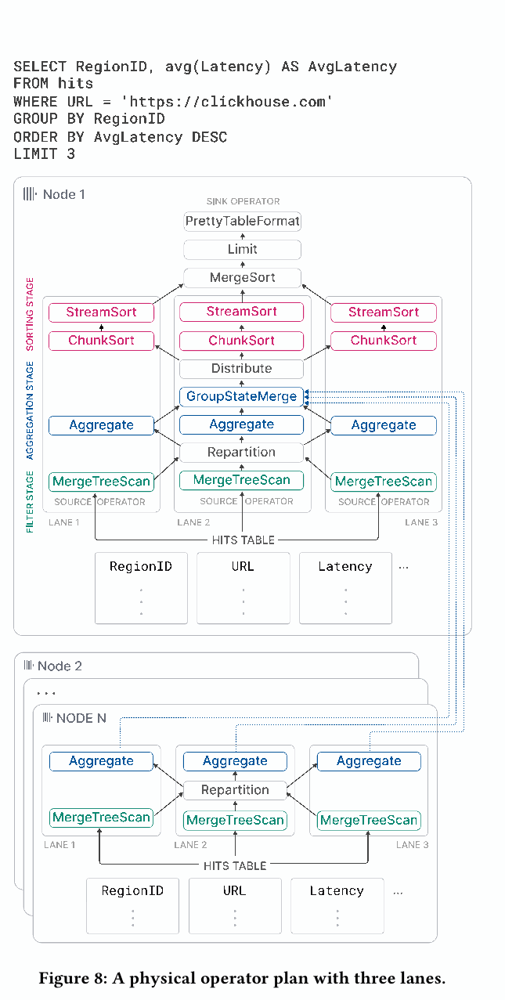

**Пример рисунка 8:** запрос фильтрует просмотры по URL, группирует по `RegionID`, считает среднюю `Latency`, сортирует группы по убыванию среднего и выбирает три результата.

1. В первой стадии три диапазона таблицы читаются и фильтруются одновременно. Если селективность диапазонов различается, объём оставшейся работы в lanes становится неравномерным. **Repartition exchange** перераспределяет чанки между следующими операторами и выравнивает нагрузку.
2. Во второй стадии локальные `Aggregate` хранят группы `RegionID` и состояния среднего `(sum, count)`. **GroupStateMerge** объединяет их в глобальный результат. Это **pipeline breaker**: следующая стадия не начнётся до завершения нужной агрегации.
3. На третьей стадии **Distribute exchange** делит результат на три непересекающиеся части. **ChunkSort** сортирует отдельные чанки; **StreamSort** постепенно объединяет отсортированные чанки своей lane двухпутевым слиянием; **MergeSort** выполняет финальное k-way-слияние. Затем применяются ограничение результата и форматирование.

**Модель оператора.** Операторы — state machines с входными и выходными портами и состояниями `need-chunk`, `ready`, `done`. Появление входного чанка переводит `need-chunk → ready`; обработка и создание выходного — `ready → done`; удаление выходного чанка — `done → need-chunk`. Передача между соседними операторами одновременно меняет состояния обоих, чтобы связывать получение входа с освобождением выхода. У source остаются состояния `ready` и `done`, у sink — `need-chunk` и `done`.

Worker threads обходят граф и выполняют доступные переходы. Подсказки в плане помогают одному потоку исполнять последовательные операторы одной lane, сохраняя данные в CPU caches. Параллелизм есть и **горизонтально**, между независимыми входами одной стадии, и **вертикально**, между операторами стадий без pipeline breaker. Например, разные агрегации могут работать одновременно, а фильтрация и обработка уже отфильтрованных чанков перекрываются по времени.

Во время запроса число работающих потоков можно менять **от одного до максимума, заданного при старте**. Это позволяет подстраиваться к появлению и завершению других запросов и избегать как избытка потоков, так и простоя ядер.

**Адаптация исполнения.** Операторы могут динамически создавать и подключать новые операторы. Основной пример — переход к внешним алгоритмам агрегации, сортировки и join при превышении порога памяти вместо отмены запроса. Также оператор может перевести worker в асинхронную очередь ожидания внешних данных, чтобы не удерживать активный поток в блокирующем ожидании удалённого источника.

**Сравнение с morsel-driven parallelism.** В обоих подходах работа распределяется между ядрами и NUMA-узлами, допускается work stealing, отсутствует единый центральный планировщик: потоки сами находят доступные задачи. Отличие описанного ClickHouse — максимальный параллелизм уже встроен в план, а исходная таблица поделена на существенно более крупные диапазоны, чем типичные morsels примерно по **100 000 строк**. Это может вызвать задержки при сильно неодинаковой стоимости фильтрации. Авторы компенсируют накопление дисбаланса между стадиями активным применением exchange-операторов, прежде всего `Repartition`; они не заявляют, что локальная неравномерность полностью исчезает.

### 4.3 Multi-Node Parallelization

Если таблица шардирована, оптимизатор **initiator node**, получившего запрос, старается выполнить максимальную часть работы на узлах с данными. Точка включения удалённого результата в локальный план зависит от доступного pushdown.

Удалённый узел может передать: исходные колонки; только строки после фильтра; группы с частичными состояниями агрегатов после фильтрации и агрегации; либо результат полного запроса, включая сортировку. Чем больше работы выполнено возле данных, тем меньше промежуточного результата обычно требуется передать инициатору.

В примере рисунка 8 узлы `2…N` фильтруют и группируют свои шарды `hits`. На Node 1 оператор `GroupStateMerge` объединяет локальные и удалённые агрегатные состояния, после чего сортируется общий результат. Таким образом, распределённое исполнение использует те же понятия частичных состояний и физических операторов, что и многоядерное исполнение на одной машине.

### 4.4 Holistic Performance Optimization

Раздел объединяет оптимизации разных стадий исполнения. Авторы подчёркивают, что высокая скорость получается совместной работой оптимизатора, физического размещения, специализированных вычислений и структур данных.

**Query optimization.** Сначала оптимизируется семантическое представление, полученное из AST. Примеры: constant folding (`concat(lower('a'), upper('b')) → 'aB'`); вынесение скаляра из агрегации (`sum(a * 2) → 2 * sum(a)`); устранение общих подвыражений; замена дизъюнкции равенств `x = c OR x = d` на `x IN (c, d)`.

Затем строится логический план, в котором выполняются filter pushdown и перестановка вычислений и сортировок с учётом оценки их стоимости. При переходе к физическому плану используются свойства движка хранения. Если требуемый `ORDER BY` совпадает с подходящим префиксом порядка хранения, отдельный оператор сортировки можно убрать и читать данные в нужном порядке. Если колонки группировки образуют префикс ключа, возможна **sort aggregation**: закончилась последовательность одинаковых ключей — агрегат можно передать дальше. Это требует меньше памяти, чем хранение всех групп в хеш-таблице, и позволяет раньше выдавать завершённые группы.

**Query compilation.** LLVM-компиляция объединяет соседние вычисления плана. Например, выражение `a * b + c + 1` исполняется как единое вычисление вместо нескольких раздельных операторов. Компиляция применяется также к одновременному вычислению нескольких агрегатов `GROUP BY` и к сравнению нескольких ключей сортировки.

Выигрыш складывается из меньшего числа виртуальных вызовов, удержания промежуточных значений в регистрах и CPU caches, меньшего объёма выполняемого кода и более удобной работы branch predictor. Дополнительно становятся доступны обычные оптимизации компилятора, включая локальные peephole-преобразования, и самые быстрые инструкции конкретного процессора. Чтобы окупить стоимость компиляции, она запускается только после превышения настраиваемого числа повторных использований выражения разными запросами. Скомпилированные операторы кэшируются для последующего использования.

**Primary key index evaluation.** Для анализа `WHERE` используются условия, которые после представления в конъюнктивной нормальной форме дают ограничения на префикс колонок первичного ключа. Лексикографические диапазоны ключей анализируются слева направо. Для каждого условия и диапазона применяется трёхзначная оценка: условие истинно для всех значений, ложно для всех либо имеет смешанный результат. В последнем случае диапазон рекурсивно делится на поддиапазоны. Так определяются области, где гранулы можно уверенно пропустить, и области, где требуется более точное рассмотрение.

Работу с функциями над ключом улучшают два механизма. **Monotonicity traits** описывают, на каких областях функция сохраняет порядок: например, `toDayOfMonth` монотонна внутри одного месяца, но не на произвольном интервале дат. Это помогает переносить диапазоны ключей в диапазоны результатов функции. **Вычисление прообраза** позволяет заменить условие на функцию условием на исходный ключ: `toYear(k) = 2024` преобразуется в `k >= '2024-01-01' AND k < '2025-01-01'`.

**Data skipping.** Помимо индексов из §3.2, ClickHouse может последовательно читать и фильтровать разные колонки: сначала наиболее отсекающий предикат, затем следующие. Порядок оценивается эвристически и, при наличии, по статистике колонок. Дальше передаются только чанки, в которых осталась хотя бы одна подходящая строка. Поэтому последующие колонки читаются для меньшей части данных, сокращаются I/O и вычисления.

Оптимизация применяется, когда есть хотя бы один **сильно отсекающий предикат**. Если почти все чанки всё равно пройдут дальше, последовательная проверка может оказаться медленнее параллельного вычисления условий. Тем самым выигрыш зависит от селективности, а не гарантируется самим наличием нескольких фильтров.

**Hash tables.** Для агрегаций и hash joins выбор структуры данных критичен. На март 2024 года ClickHouse создавал **более 30 вариантов хеш-таблиц** из общего шаблона, меняя хеш-функцию, allocator, представление ячейки и политику изменения размера. Вариант выбирается **для отдельного оператора** по типам ключей, ожидаемой кардинальности и другим свойствам.

Перечислены восемь дополнительных оптимизаций:

- Двухуровневая структура из **256 подтаблиц**, выбираемых по первому байту хеша, для больших наборов ключей.
- Специализация для строк: **четыре подтаблицы** и разные хеш-функции в зависимости от длины строки.
- Lookup tables для маленького множества возможных ключей: значение непосредственно задаёт индекс ячейки, хеширование не требуется.
- Сохранение хеша вместе со значением, чтобы дешевле разрешать коллизии при дорогом сравнении, например строк или AST.
- Начальное выделение таблицы по прогнозу размера из runtime statistics, уменьшающее число перераспределений.
- Выделение нескольких маленьких таблиц с общим временем жизни на одном memory slab.
- Быстрое логическое очищение для повторного использования через счётчики версий таблицы и её ячеек.
- CPU prefetch, в частности `__builtin_prefetch`, для предварительной подгрузки ячейки после вычисления хеша.

**Joins.** Исторически ограниченная поддержка соединений подталкивала пользователей ClickHouse к денормализации. В описанной версии доступны inner, left/right/full outer, cross и as-of joins, а также разные алгоритмы: обычный и grace hash join, sort-merge join и index join для движков с быстрым lookup по ключу, обычно dictionaries.

Join дорог, поэтому важны параллельные алгоритмы и управляемый обмен памяти на время. Для parallel hash join используется **non-blocking shared partition algorithm** из работы [7].

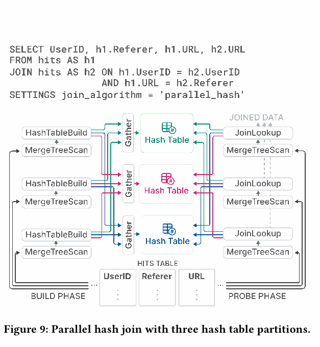

**Рисунок 9:** self-join таблицы просмотров восстанавливает переходы пользователей между URL по `UserID` и связи URL/referrer. На build phase три lanes читают непересекающиеся диапазоны. Вместо одной общей таблицы используются несколько разделов хеш-таблицы; раздел выбирается по остатку от деления хеша. **Gather exchange** координирует поступление строк в разделы. Probe phase аналогично направляет проверяемые строки в нужную таблицу. Дополнительное распределение требует двух лишних вычислений хеша на tuple, но уменьшает конкуренцию за latches во время build; результат зависит от числа разделов. Это конкретный компромисс между дополнительными вычислениями и синхронизацией.

### 4.5 Workload Isolation

Запросы разделяются на **workload classes**, для которых ограничиваются общие ресурсы: CPU cores, DRAM, дисковый и сетевой I/O. Это нужно, чтобы массовая менее важная работа не отбирала все ресурсы у критичных бизнес-запросов.

**Concurrency control** динамически меняет число workers запроса относительно числа доступных CPU cores, предотвращая oversubscription при множестве запросов.

**Память** учитывается по размерам выделений на уровне сервера, пользователя и запроса. Лимиты можно задавать на каждом уровне. **Memory overcommit** позволяет временно занять свободную память сверх гарантированной доли, сохраняя гарантии для других запросов. Отдельные пороги агрегации, сортировки и join могут запускать переход к внешним алгоритмам вместо немедленной отмены работы.

**I/O scheduling** ограничивает доступ к локальному и удалённому хранилищу по пропускной способности, числу одновременно находящихся в работе запросов и политике обслуживания. Статья приводит FIFO и SFC и ссылается на работу о start-time fair queueing. Таким образом, изоляция охватывает не только число одновременно выполняемых SQL-запросов, но и потребление основных физических ресурсов.

## 5. INTEGRATION LAYER

Оперативным аналитическим приложениям нужен доступ к данным из разных мест. Авторы сравнивают две модели интеграции. При **push** внешний компонент, например ETL, забирает данные из источника и загружает их в СУБД. При **pull** СУБД сама обращается к источнику, читает данные для запроса или локальной таблицы и может записывать результаты обратно.

Push-подход распространён и универсален, но добавляет компоненты инфраструктуры и потенциальное узкое место масштабирования. Встроенная удалённая связность позволяет упростить архитектуру, быстрее получить данные для анализа и, например, соединять локальные данные с удалёнными в одном запросе.

Сама идея не новая: **SQL/MED** предложен в 2001 году, а PostgreSQL поддерживает foreign data wrappers с 2011-го. Особенность ClickHouse авторы видят в максимально широкой встроенной совместимости. Утверждение, что у него больше всего встроенных вариантов интеграции среди аналитических СУБД, сформулировано как оценка авторов **на март 2024 года**, а не как доказанное универсальное сравнение всех продуктов.

**External Connectivity.** Упоминаются **более 50** интеграционных табличных функций и движков: ODBC, MySQL, PostgreSQL, SQLite, Kafka, Hive, MongoDB, Redis, S3, Google Cloud Storage, Azure и различные data lakes. Актуальный набор можно смотреть через системные таблицы, на которые дана ссылка в сноске статьи.

**Temporary access with Integration Table Functions.** Для разового исследовательского запроса функция указывается прямо в `FROM` и читает внешний источник. Для записи используется `INSERT INTO TABLE FUNCTION`. Постоянный объект в локальном каталоге для каждого такого обращения создавать не требуется.

**Persisted access.** Описаны три способа сохранить связь с внешним источником.

1. **Integration table engine** представляет внешний объект, например таблицу MySQL, локальной таблицей-прокси либо локальной копией. В определении сохраняются источник и схема; статья описывает создание через `CREATE TABLE ... AS` с `SELECT` и табличной функцией. Пользователь может выбрать подмножество колонок или позволить schema inference определить имена и соответствующие типы ClickHouse. **Пассивный** движок обращается к удалённой системе во время запроса; **активный** периодически подтягивает данные или подписывается на изменения, например через logical replication PostgreSQL, и поддерживает полную локальную копию.
2. **Integration database engine** отображает сразу таблицы внешней схемы базы. Обычно требуется реляционная СУБД; дополнительно предоставляется ограниченная поддержка DDL.
3. **Dictionary** наполняется результатом произвольного запроса почти к любому источнику с подходящим интеграционным интерфейсом. Поведение активное: данные периодически считываются из внешнего хранилища и используются для быстрых lookup.

**Data Formats.** Кроме нативного формата, поддерживаются **более 90** форматов, включая CSV, JSON, Parquet, Avro, ORC, Arrow и Protobuf. Формат может быть только входным, только выходным либо двунаправленным. Поддержка аналитических форматов глубже простого чтения файла: для Parquet оптимизатор использует встроенную статистику и возможности работы с предикатами над сжатым представлением, уменьшая лишнюю обработку.

**Compatibility interfaces.** Помимо нативного протокола и HTTP, имеются интерфейсы, совместимые с wire protocols MySQL и PostgreSQL. Это позволяет подключать приложения, например некоторые закрытые BI-инструменты, разработчики которых ещё не добавили нативный драйвер ClickHouse.

## 6. PERFORMANCE AS A FEATURE

Высокая производительность рассматривается вместе со средствами её исследования. Раздел сначала показывает встроенную наблюдаемость, затем — результаты разных типов нагрузок и развитие быстродействия по версиям.

### 6.1 Built-in Performance Analysis Tools

Общий интерфейс инструментов анализа — **system tables**. Через них исследуются отдельные запросы и фоновые операции, а не только итоговая скорость сервера.

**Server and query metrics.** Метрики сервера включают число активных parts, сетевой throughput и cache hit rates. Метрики отдельного запроса — например, число прочитанных блоков и сведения об использовании индексов. Некоторые значения вычисляются синхронно по запросу, другие обновляются асинхронно с настраиваемым периодом.

**Sampling profiler.** Периодически снимает call stacks серверных потоков. Результаты можно экспортировать во внешние средства, включая визуализацию flame graphs, чтобы найти участки кода, на которые приходится основная работа.

**OpenTelemetry integration.** ClickHouse создаёт spans по шагам обработки запроса с настраиваемой детализацией. Он может также принимать и анализировать spans других систем. Это связывает локальную работу СУБД с общим потоком данных распределённого приложения.

**Explain query.** `EXPLAIN` перед `SELECT` предоставляет сведения об AST, логическом и физическом планах и аспектах исполнения. В сочетании с фактическими метриками это позволяет объяснять причину ускорения: сколько работы было исключено, какой алгоритм выбран и где осталось узкое место.

### 6.2 Benchmarks

Авторы признают критику синтетических бенчмарков: они не всегда отражают реальные приложения. Тем не менее фиксированные нагрузки полезны для выявления сильных и слабых сторон СУБД. Поэтому приводятся отдельно денормализованные таблицы, динамика версий и нормализованные аналитические запросы.

#### 6.2.1 Denormalized Tables

**ClickBench.** Историческая основная нагрузка ClickHouse — фильтрация и агрегация денормализованных fact tables. ClickBench моделирует исследовательскую аналитику, периодическую отчётность, clickstream и анализ трафика: **43 запроса к 100 млн анонимизированных просмотров страниц** одного из крупных веб-аналитических сервисов.

На июнь 2024 года dashboard содержал результаты более **45 коммерческих и исследовательских СУБД**. Публичны входные данные и SQL; результаты присылают независимые участники. Помимо cold/hot-времени, собираются время загрузки и размер данных на диске. Набор проверяет последовательные и индексные пути чтения и содержит операторы, ограниченные CPU, I/O или памятью.

**Условия измерений рисунка 10.** Основная машина — один AWS EC2 `c6a.4xlarge`, **16 vCPU, 32 GB RAM**, диск **5000 IOPS / 1000 MiB/s**. Для Redshift использован `ra3.4xlarge`, **12 vCPU и 96 GB RAM**; для Snowflake — warehouse **S**, **2 × 8 vCPU и 2 × 16 GB RAM**. Авторы считают системы сопоставимыми, но приведённые характеристики показывают, что ресурсы не полностью идентичны.

Физический дизайн настраивается ограниченно: указываются первичные ключи, но не подбираются кодеки отдельных колонок, не создаются projections или skipping indices. Перед каждым cold-запуском сбрасывается Linux page cache; прочие настройки ОС и СУБД не подбираются. Все запросы выполняются последовательно.

**Нормировка.** Для каждого запроса baseline — минимальное время среди сравниваемых СУБД. Относительное время вычисляется как `(t_query + 10 ms) / (t_best + 10 ms)`. Добавка 10 ms смягчает влияние очень маленьких времён. Общий показатель — геометрическое среднее этих отношений. Это показатель относительного выполнения всего набора, а не суммарное число секунд; лучший baseline разных запросов может принадлежать разным системам.

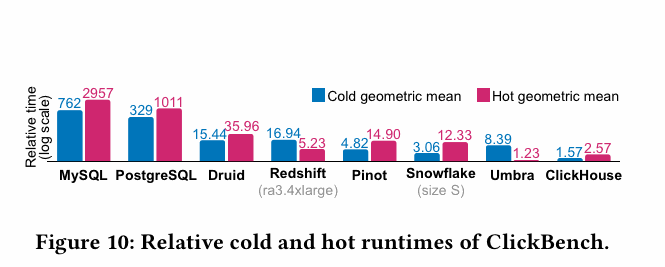

| Система | Cold: геометрическое среднее отношений | Hot: геометрическое среднее отношений |
|---|---:|---:|
| MySQL | 762 | 2957 |
| PostgreSQL | 329 | 1011 |
| Druid | 15,44 | 35,96 |
| Redshift `ra3.4xlarge` | 16,94 | 5,23 |
| Pinot | 4,82 | 14,90 |
| Snowflake S | 3,06 | 12,33 |
| Umbra | 8,39 | 1,23 |
| ClickHouse | 1,57 | 2,57 |

Меньшее значение лучше. Cold и hot нормированы относительно соответствующих лучших запусков, поэтому сами числа в двух столбцах не показывают абсолютное отношение скорости холодного и прогретого выполнения. Исследовательская Umbra имеет лучший общий hot-результат. Среди представленных production-grade-систем ClickHouse показывает лучший общий cold- и hot-результат. Этот вывод относится к указанному набору, ресурсам и методике, а не означает победу в каждом запросе.

**VersionsBench.** Для отслеживания `SELECT`-производительности по версиям раз в месяц, при выходе релиза, выполняется смесь четырёх нагрузок:

1. ClickBench.
2. **15 запросов MgBench**.
3. **13 запросов** к денормализованной fact table Star Schema Benchmark на **600 млн строк**.
4. **4 запроса NYC Taxi Rides** на **3,4 млрд строк**.

Измерения помогают заметить деградацию и найти вызвавшие её изменения кода. Для сопоставления запросов разной длительности используется нормировка относительно минимального времени соответствующего запроса среди версий и агрегирование геометрическим средним; рисунок обозначен как **weighted geometric mean**.

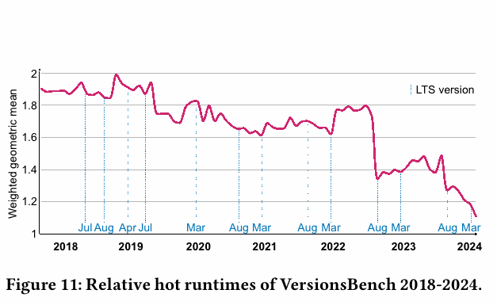

**Рисунок 11** охватывает **77 версий, март 2018 — март 2024**. За шесть лет общий показатель улучшился в **1,72 раза**. На шкале отмечены LTS-релизы: временные ухудшения встречаются, но очередная LTS обычно сопоставима с предыдущей или быстрее. Заметное улучшение в августе 2022 года авторы связывают с последовательным чтением и фильтрацией колонок из §4.4. Это связывает конкретную оптимизацию с изменением измеряемой нагрузки, а не просто с номером релиза.

#### 6.2.2 Normalized tables

Для классических схем star/snowflake приводится **TPC-H, scale factor 100**. Нормализованные таблицы на момент статьи — развивающийся сценарий ClickHouse. Измерения используют описанный в §4.4 parallel hash join.

Стенд ClickHouse — один AWS EC2 `c6i.16xlarge`: **64 vCPU, 128 GB RAM**, **5000 IOPS / 1000 MiB/s**. Для сравнения использован Snowflake warehouse **L**, **8 × 8 vCPU и 8 × 16 GB RAM**. Для каждого запроса записан **самый быстрый из пяти запусков**, рассматриваются hot-времена.

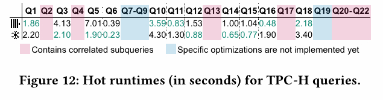

| Запрос TPC-H | ClickHouse, s | Snowflake, s | Меньшее время |
|---|---:|---:|---|
| Q1 | 1,86 | 2,20 | ClickHouse |
| Q3 | 4,13 | 2,10 | Snowflake |
| Q5 | 7,01 | 1,90 | Snowflake |
| Q6 | 0,39 | 0,23 | Snowflake |
| Q10 | 3,59 | 4,30 | ClickHouse |
| Q11 | 0,83 | 1,30 | ClickHouse |
| Q12 | 1,53 | 0,88 | Snowflake |
| Q14 | 1,00 | 0,65 | Snowflake |
| Q15 | 1,04 | 0,77 | Snowflake |
| Q16 | 0,48 | 1,90 | ClickHouse |
| Q18 | 2,18 | 3,40 | ClickHouse |

**Одиннадцать из 22 запросов исключены**, и причины существенны для интерпретации:

- **Q2, Q4, Q13, Q17, Q20–Q22** содержат correlated subqueries, не поддерживаемые ClickHouse **24.6**.
- **Q7–Q9 и Q19** требуют развитых плановых оптимизаций join для приемлемого времени: join reordering и join predicate pushdown также отсутствовали в 24.6.

На оставшихся одиннадцати запросах ClickHouse быстрее в **пяти**, Snowflake — в **шести**. Это частичное сравнение, а не результат полного TPC-H-набора. Автоматическую decorrelation подзапросов и улучшение join-оптимизатора планировали на 2024 год. Авторы ожидают дальнейшего ускорения, поскольку известна важность этих оптимизаций, но будущий выигрыш в приведённых данных ещё не измерен.

## 7. RELATED WORK

**Развитие аналитических систем.** Ранние Sybase IQ, Teradata, Vertica и Greenplum сочетались с дорогими пакетными ETL и ограниченной эластичностью on-premise-развёртываний. В начале 2010-х облачные Snowflake, BigQuery и Redshift снизили стоимость и сложность аналитической инфраструктуры, добавив высокую доступность и автоматическое масштабирование. Следующий этап — отдельные execution kernels, например Photon и Velox, используемые в разных аналитических, потоковых и ML-системах.

**Druid и Pinot.** Это наиболее близкие системы по целям: real-time analytics и высокая скорость загрузки. Данные также делятся на горизонтальные сегменты. ClickHouse непрерывно объединяет parts и может во время слияний сокращать исторические данные; у Druid и Pinot авторы подчёркивают неизменяемость сегментов. Для создания, изменения и поиска в этих системах используются специализированные узлы, тогда как ClickHouse объединяет соответствующие функции в одном монолитном бинарном файле.

**Snowflake.** Проприетарное облачное хранилище использует shared-disk-архитектуру и micro-partitions, концептуально похожие на parts. Формат Snowflake основан на гибридных страницах **PAX**, формат ClickHouse — строго поколоночный. В обоих случаях важны локальное кэширование и pruning по компактным индексам. В Snowflake такие структуры создаются автоматически; пользователь может дополнительно задавать кластеризацию близких значений, сопоставимую по назначению с упорядочиванием в ClickHouse.

**Photon и Velox.** Эти движки получают план от внешней системы и исполняют его локально над Parquet для Photon и Arrow для Velox. ClickHouse умеет читать и писать оба формата, но для постоянного хранения предпочитает собственный. Photon и Velox в основном не оптимизируют переданный план; для Velox отдельно отмечены базовые оптимизации выражений. Они используют runtime adaptivity, например меняют compute kernel по свойствам данных. В ClickHouse похожая адаптация проявляется в динамическом подключении операторов, прежде всего при переходе на внешние агрегации и joins из-за памяти.

Авторы Photon отмечают, что code-generating execution сложнее разрабатывать и отлаживать, чем интерпретируемое векторизованное исполнение. Экспериментальная компиляция Velox генерирует C++, собирает shared library и подключает её. ClickHouse обращается непосредственно к LLVM API компиляции по запросу. Поэтому общая идея специализации вычислений реализована с разной сложностью и разными границами интеграции.

**DuckDB.** Система встраивается в процесс приложения, но также включает оптимизатор и транзакции. Она рассчитана на OLAP с эпизодическими OLTP-операциями и использует формат **DataBlocks** с лёгкими методами сжатия, например сохраняющими порядок словарями и frame-of-reference, подходящими для смешанной нагрузки.

ClickHouse ориентирован на append-only-сценарии с редкими изменениями. Его сжатые блоки используют, в терминологии сравнения статьи, более тяжёлое общее сжатие вроде LZ4. Расчёт состоит в том, что частые запросы пропустят большую часть данных через pruning, а в остальных стоимость I/O будет выше стоимости декомпрессии. Для транзакций DuckDB использует serializable MVCC, основанный на подходе HyPer; ClickHouse в изложении статьи предоставляет snapshot isolation с ограничениями §3.7. Таким образом, различие целевой нагрузки объясняет различия хранения, компрессии и гарантий.

## 8. CONCLUSION AND OUTLOOK

Архитектура ClickHouse соединяет ориентированное на интенсивную запись хранение и современный векторизованный движок для оперативной аналитики над петабайтами. Асинхронные слияния отделяют обслуживание и преобразование накопленных данных от новых вставок. Разреженный первичный индекс, skipping indices и projections сокращают объём работы до исполнения операторов над всеми строками.

Авторы суммируют поддержку обновлений и удалений, идемпотентной повторной отправки вставок, репликации для доступности, нескольких уровней параллелизма, многочисленных оптимизаций запросов и интеграции с внешними данными и форматами. Бенчмарки показывают сильные результаты на аналитической нагрузке и улучшение типичных запросов на протяжении нескольких лет. При этом нормализованные запросы и ограничения оптимизатора остаются явным направлением развития.

В публичный **roadmap на 2024 год** входили пользовательские транзакции, PromQL как альтернативный язык запросов, новый тип для полуструктурированных данных вроде JSON, улучшенные оптимизации join на уровне плана и lightweight updates в дополнение к lightweight deletes. Это планы, перечисленные авторами, а не перечень возможностей, уже подтверждённых измерениями статьи.

## ACKNOWLEDGMENTS

Для версии **24.6** запрос `SELECT * FROM system.contributors` возвращал **1994 участников разработки**. Авторы благодарят инженерную команду ClickHouse Inc. и сообщество открытого проекта, совместно развивавших систему.

## REFERENCES

В оригинале **81 библиографическая запись**. Ниже сохранены их номера и предмет ссылок, чтобы можно было сопоставить аргументы саммари с полной библиографией на страницах 3743–3744 PDF. Это указатель источников статьи; сами перечисленные работы здесь отдельно не пересказываются.

| № | Работа или ресурс и зачем он упоминается |
|---|---|
| 1 | Abadi et al., 2013 — обзор устройства современных column-oriented СУБД; общий контекст аналитических систем. |
| 2 | Abadi, Madden, Ferreira, 2006 — интеграция сжатия и исполнения в колоночных СУБД; словари и лёгкая компрессия. |
| 3 | Ailamaki et al., 2001, *Weaving Relations for Cache Performance* — PAX и эффективное размещение данных для CPU cache. |
| 4 | Armenatzoglou et al., 2022, *Amazon Redshift Re-Invented* — современное облачное аналитическое хранилище. |
| 5 | Behm et al., 2022, *Photon* — векторизованный query engine для lakehouse, адаптация исполнения и компромиссы code generation. |
| 6 | Bernstein, Goodman, 1981 — управление конкурентным доступом; теоретический контекст MVCC и изоляции. |
| 7 | Blanas, Li, Patel, 2011 — hash join на многоядерных CPU; источник shared-partition-подхода. |
| 8 | Blanco, 2023, *Practical OpenTelemetry* — распределённые traces и spans. |
| 9 | Bloom, 1970 — фильтр с допустимыми ложными срабатываниями и компромисс памяти и точности. |
| 10 | Boncz, Neumann, Erling, 2014, *TPC-H Analyzed* — возможности и ограничения интерпретации бенчмарков. |
| 11 | Boncz, Zukowski, Nes, 2005, *MonetDB/X100* — векторизованное выполнение чанками и hyper-pipelining. |
| 12 | Burtscher, Ratanaworabhan, 2007 — высокопроизводительное сжатие double; FPC. |
| 13 | Carpenter, Hewitt, 2016 — Cassandra как пример LSM-ориентированного хранилища. |
| 14 | Charron-Bost, Pedone, Schiper, 2010 — теория и практика репликации. |
| 15 | [chDB](https://github.com/chdb-io/chdb) — встраиваемый OLAP SQL engine. |
| 16 | [ClickBench: код и нагрузка](https://github.com/ClickHouse/ClickBench). |
| 17 | [ClickBench: сравнительные измерения](https://benchmark.clickhouse.com/). |
| 18 | [ClickHouse Roadmap 2024](https://github.com/ClickHouse/ClickHouse/issues/58392) — заявленные планы развития. |
| 19 | [VersionsBench: код](https://github.com/ClickHouse/ClickBench/tree/main/versions). |
| 20 | [VersionsBench: результаты](https://benchmark.clickhouse.com/versions/). |
| 21 | [MgBench](https://github.com/andrewcrotty/mgbench) — одна из нагрузок VersionsBench. |
| 22 | Dageville et al., 2016, *The Snowflake Elastic Data Warehouse* — shared-disk, micro-partitions и облачная архитектура. |
| 23 | Damme et al., 2019 — выбор лёгких методов целочисленной компрессии, включая delta coding. |
| 24 | Dobbelaere, Esmaili, 2017 — сравнительная работа о Kafka и RabbitMQ. |
| 25 | [LLVM Auto-Vectorization](https://llvm.org/docs/Vectorizers.html) — автоматическая SIMD-векторизация компилятором. |
| 26 | Dong et al., 2021, *RocksDB* — развитие LSM-хранилища для крупных прикладных систем. |
| 27 | Dreseler et al., 2020 — узкие места TPC-H и важность соответствующих оптимизаций. |
| 28 | Dunning, 2021 — t-digest для компактного описания распределений. |
| 29 | Faust et al., 2016 — хеш-индексы и контроль уникальности в SAP HANA. |
| 30 | Flajolet et al., 2007 — HyperLogLog для оценки числа различных значений. |
| 31 | Garcia-Molina, Ullman, Widom, 2009, *Database Systems: The Complete Book* — общие механизмы индексов, планов и хранения. |
| 32 | Goyal, Vin, Chen, 1996 — start-time fair queueing для распределения I/O. |
| 33 | Graefe, 1993 — техники исполнения запросов, в том числе sort aggregation. |
| 34 | Im et al., 2018, *Pinot* — real-time OLAP с высокой скоростью поступления данных. |
| 35 | ISO/IEC 9075-9:2001, SQL/MED — стандарт управления внешними данными. |
| 36 | Jain et al., 2023 — сравнение lakehouse storage systems. |
| 37 | [Jupyter Notebooks](https://jupyter.org/) — интерактивный сценарий встраиваемой аналитики. |
| 38 | Kersten et al., 2018 — сравнение compiled и vectorized query execution. |
| 39 | Kim et al., 2010, *FAST* — поиск по индексным деревьям с учётом архитектуры CPU/GPU. |
| 40 | Knuth, 1973, *Sorting and Searching* — алгоритмы сортировки, поиска и слияния. |
| 41 | Kohn, Leis, Neumann, 2018 — адаптивное исполнение скомпилированных запросов. |
| 42 | Lamb et al., 2012, *Vertica* — эволюция C-Store в аналитическую СУБД. |
| 43 | Lang et al., 2016, *Data Blocks* — сжатое хранение для смешанных OLTP/OLAP с векторизацией и компиляцией. |
| 44 | Leis et al., 2014 — morsel-driven, NUMA-aware parallelism. |
| 45 | Leis, Kemper, Neumann, 2013 — Adaptive Radix Tree как структура для точечных поисков в памяти. |
| 46 | Liu et al., 2023 — обзор открытых форматов аналитических СУБД. |
| 47 | Lyu et al., 2021, *Greenplum* — гибридная транзакционная и аналитическая система. |
| 48 | MacNicol, French, 2004, *Sybase IQ Multiplex* — ранняя аналитическая архитектура. |
| 49 | Melnik et al., 2020, *Dremel* — интерактивная SQL-аналитика веб-масштаба, контекст BigQuery. |
| 50 | [Kusto Query Language](https://github.com/microsoft/Kusto-Query-Language) — альтернативный входной язык. |
| 51 | Moerkotte, 1998 — компактные материализованные агрегаты как лёгкие индексы для pruning. |
| 52 | Mostafa et al., 2022, *SciTS* — специализированные бенчмарки временных рядов. |
| 53 | Neumann, 2011 — эффективная компиляция физических планов под современное оборудование. |
| 54 | Neumann, Freitag, 2020, *Umbra* — исследовательская дисковая СУБД с высокой скоростью выполнения. |
| 55 | Neumann, Mühlbauer, Kemper, 2015 — быстрое serializable MVCC в СУБД в памяти. |
| 56 | [LevelDB](https://github.com/google/leveldb) — ещё один пример LSM-хранилища. |
| 57 | O’Neil et al., 2009 — Star Schema Benchmark. |
| 58 | O’Neil et al., 1996 — исходная работа о LSM-tree. |
| 59 | Ongaro, Ousterhout, 2014 — консенсус Raft. |
| 60 | O’Neil et al., 1996 — повторная библиографическая запись той же работы о LSM-tree, с другим оформлением. |
| 61 | [Pandas Dataframes](https://pandas.pydata.org/) — прикладное окружение in-process-аналитики. |
| 62 | Pedreira et al., 2022, *Velox* — общий execution engine Meta. |
| 63 | Pelkonen et al., 2015, *Gorilla* — сжатие и хранение временных рядов. |
| 64 | Polychroniou, Raghavan, Ross, 2015 — SIMD для СУБД в памяти. |
| 65 | [PostgreSQL Foreign Data Wrappers](https://wiki.postgresql.org/wiki/Foreign_data_wrappers) — практическая реализация внешних таблиц. |
| 66 | Raasveldt et al., 2018 — ошибки и сложности честного сравнения производительности СУБД. |
| 67 | Raasveldt, Mühleisen, 2019, *DuckDB* — встраиваемая аналитическая база. |
| 68 | Rao, Ross, 1999 — cache-conscious indexing для decision-support-нагрузок. |
| 69 | Sabharwal, Pandey, 2020 — PromQL; упомянут в планах развития. |
| 70 | [NYC Taxi and For-Hire Vehicle Data](https://github.com/toddwschneider/nyc-taxi-data) — источник крупной нагрузки VersionsBench. |
| 71 | Stonebraker et al., 2005, *C-Store* — колоночная СУБД и альтернативные физические представления. |
| 72 | Teradata Database — промышленная аналитическая СУБД. |
| 73 | Transier, 2010 — структуры данных для текстового поиска в памяти. |
| 74 | Vogelsgesang et al., 2018, *Get Real* — расхождения между бенчмарками и реальной нагрузкой. |
| 75 | [LZ4](https://lz4.org/) — используемое блочное сжатие. |
| 76 | [PRQL](https://prql-lang.org/) — альтернативный язык запросов. |
| 77 | Westmann et al., 2000 — реализация и производительность сжатых СУБД. |
| 78 | Yang et al., 2014, *Druid* — real-time analytical data store. |
| 79 | Zheng, Zhang, Cheng, 2020, *SAHA* — адаптивные хеш-таблицы строк. |
| 80 | Zhou, Ross, 2002 — SIMD-реализация операций СУБД. |
| 81 | Zukowski et al., 2006 — компрессия с учётом RAM/CPU cache. |

**Материалы из сносок.** В статье дополнительно даны ссылки на историю проекта (`clickhou.se/evolution`), dictionaries (`clickhou.se/dictionaries`), Keeper (`clickhou.se/keeper`), standalone/local (`clickhou.se/local`, `clickhou.se/local-fastest-tool`), chDB (`clickhou.se/chdb-rocket-engine`), CPU dispatch (`clickhou.se/cpu-dispatch`), JIT (`clickhou.se/jit`), хеш-таблицы (`clickhou.se/hashtables`), joins (`clickhou.se/joins`), списки интеграций и форматов (`clickhou.se/query-integrations`, `clickhou.se/query-formats`), размеры Redshift и Snowflake (`clickhou.se/redshift-sizes`, `clickhou.se/snowflake-sizes`), изменение производительности по годам (`clickhou.se/performance-over-years`) и NYC Taxi benchmark (`clickhou.se/nyc-taxi-rides-benchmark`). Все они служат дополнительными пояснениями; основным источником этого саммари остаётся PDF статьи.
