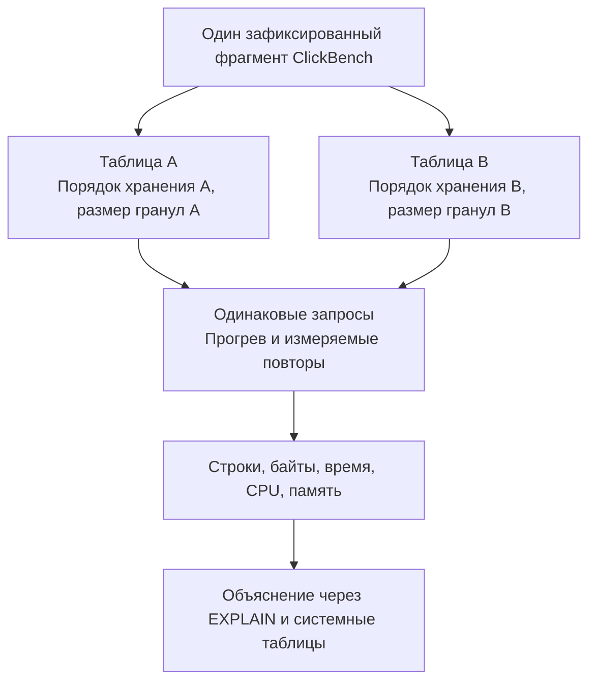

# Участник 1: что мы исследуем и что тебе сделать к КТ1

**Твоя роль по текущему распределению — окружение и данные.** Ты выбираешь способ уменьшения ClickBench и начальный объём, готовишь запускаемый ClickHouse, небольшой вход и простой проверочный запрос. Затем передаёшь команде команды, описание выборки, фактические результаты проверок и сведения о доступных ресурсах.

Фактические результаты и оценка ресурсов собраны в [КТ1](./nis/checkpoints/01.md#технические-проверки). Команды находятся в [инструкции технических проверок](./nis/technical-checks.md), запуск ClickHouse на ARM64 и x86-64 описан в [инструкции Docker](./docker/checkpoint-1/README.md).

**Срок КТ1:** 03.11.2026, 23:59. Внутреннюю последовательность работы команда согласует сама.

Основание: [карточка P12-A](https://distsys.ru/osukhoroslov/nis2/src/branch/main/project-tasks/p12-a-clickhouse-data-skipping.md), [требования КТ1](https://distsys.ru/osukhoroslov/nis2/src/branch/main/project-checkpoints/01-project-plan.md) и [общий план команды](./checkpoint-1-plan-ru.md). Ниже — инструкция для предстоящей работы. Числа и конфигурации в учебных примерах иллюстрируют механизм; окончательные параметры эксперимента команда ещё выбирает.

Быстрые переходы: [смысл исследования](#1-что-конкретно-мы-хотим-исследовать), [твои задачи по шагам](#4-твои-задачи-к-кт1-по-шагам), [чек-лист готовности](#6-как-понять-что-твоя-часть-кт1-готова).

## 1. Что конкретно мы хотим исследовать

**Наш вопрос: как меняются объём чтения и стоимость запроса, если одни и те же данные хранить в разном порядке и с разным размером гранул? В каких случаях фильтр позволяет пропустить большую часть данных, а в каких — почти ничего?**

Допустим, есть таблица событий: кто открыл страницу, когда это произошло, какой сайт или счётчик обслуживал запрос. Нам нужно, например, посчитать просмотры одного сайта за определённое время. Подходящие строки могут быть собраны рядом или находиться вперемешку с остальными. Это влияет на то, сколько данных ClickHouse придётся проверить.

В проекте у компонентов такие роли:

| Компонент | Что он даёт |
|---|---|
| **ClickHouse** | Хранит таблицы, строит индекс и исполняет запросы. |
| **ClickBench** | Даёт набор данных веб-аналитики, схему, запросы и примеры запуска измерений. |
| **Наша команда** | Готовит уменьшенный набор, два варианта хранения и воспроизводимое сравнение; объясняет измеренные различия. |

Набор ClickBench и его назначение описаны в [репозитории авторов](https://github.com/ClickHouse/ClickBench). Для своей работы нужно использовать ревизию из карточки задания, а не автоматически брать текущую `main`.

Общая схема будущего эксперимента:



### 1.1. Почему порядок строк вообще влияет на запрос

В `MergeTree` параметр `ORDER BY` в определении таблицы, `CREATE TABLE`, задаёт порядок строк внутри каждой **part**. Part — отдельная сохранённая часть таблицы со своим отсортированным рядом. В ней строки разбиты на **гранулы**: группы, по которым разреженный первичный индекс помогает выбирать диапазоны чтения.

Учебный пример: 12 событий, среди которых 4 события из RU. Для наглядности возьмём гранулы по 4 строки. Посмотрим только на колонку страны.

**Вариант A: строки упорядочены по другому признаку, страны перемешаны.**

```text
Гранула 1: DE FR RU DE
Гранула 2: FR RU DE FR
Гранула 3: RU DE FR RU
```

При фильтре `country = 'RU'` подходящие строки находятся в каждой грануле. Пропустить целую гранулу по этому условию здесь не получится.

**Вариант B: те же события упорядочены по стране.**

```text
Гранула 1: DE DE DE DE
Гранула 2: FR FR FR FR
Гранула 3: RU RU RU RU
```

Теперь нужные строки находятся в узком диапазоне. Индекс по стране позволяет исключать заведомо неподходящие диапазоны. **Ответ в обоих случаях одинаковый — 4 события, но объём необходимой работы может различаться.**

В идеализированном выборе это 12 проверяемых строк против 4. Реальный разреженный индекс может захватить соседние гранулы на границах: он хранит информацию по гранулам, а не позицию каждой строки. Поэтому точное число выбранных гранул нужно смотреть в `EXPLAIN`, а фактическое чтение — в измерениях.

Этот пример объясняет принцип. В настоящем ClickBench будем работать с его колонками и выбранными командой запросами. Устройство индекса разобрано в [саммари, §3.1–3.2](./clickhouse-summary-ru.md#31-on-disk-format).

### 1.2. Что меняет размер гранулы

Когда индекс находит нужный диапазон, вместе с подходящими строками в чтение могут попадать соседние строки той же гранулы. Меньшая гранула позволяет точнее ограничить этот диапазон.

Учебный пример: строки отсортированы по `id`, запрос ищет `id = 6`.

```text
Гранулы по 8 строк:
[1 2 3 4 5 6 7 8] [9 10 11 12 13 14 15 16]
         ↑ нужная строка внутри группы из 8 строк

Гранулы по 4 строки:
[1 2 3 4] [5 6 7 8] [9 10 11 12] [13 14 15 16]
            ↑ нужная строка внутри группы из 4 строк
```

Но мелких гранул больше: увеличиваются число индексных записей и меток, расходы на их хранение и обработку. Кроме того, данные физически читаются сжатыми блоками, границы которых не обязаны совпадать с границами гранул. Поэтому уменьшение гранулы не обещает такое же пропорциональное уменьшение дискового чтения или времени.

В настройках важны `index_granularity` и `index_granularity_bytes`: при адаптивной гранулярности число строк ограничивается также объёмом данных в байтах. В эксперименте нужно зафиксировать обе настройки. Подробнее — [документация MergeTree](https://clickhouse.com/docs/reference/engines/table-engines/mergetree-family/mergetree#data-storage).

### 1.3. Что означает селективность

Здесь будем называть селективностью **долю исходных строк, удовлетворяющих фильтру**:

```text
селективность = число подходящих строк / число строк таблицы
```

Например, из 1 000 000 событий условию соответствуют 1 000: доля совпадений — 0,1%. Такой фильтр сильно отсекает строки.

Однако эти 1 000 событий могут находиться рядом или быть распределены по множеству гранул. Поэтому одинаковая селективность ещё не означает одинаковое чтение.

Число строк результата после агрегации — другой показатель. `SELECT count() ...` возвращает одну строку и при тысяче совпадений, и при миллионе. Для селективности нужно учитывать строки, прошедшие фильтр до агрегирования.

### 1.4. Какие ситуации имеет смысл сравнивать

Например, для объяснения можно представить два варианта:

| Вариант | Ключ сортировки | Размер гранулы по строкам |
|---|---|---:|
| A, выбранный baseline | `(UserID, EventTime)` | 8192 |
| B | `(CounterID, EventTime)` | 2048 |

**Это учебный пример, а не утверждённые настройки проекта.** Baseline здесь — исходная конфигурация ClickHouse, относительно которой считаем изменения. Выбор делает команда вместе с участником 2.

Для таких ключей можно обсуждать следующие сценарии:

| Пример условия | Что хотим выяснить |
|---|---|
| Один присутствующий в данных `CounterID` | Помогает ли размещение событий одного счётчика рядом? |
| `CounterID` и узкий диапазон `EventTime` | Как работает фильтр, согласованный с составным ключом? |
| Тот же счётчик, но всё более широкий интервал | Как меняется эффект при росте доли совпадений? |
| Один присутствующий `UserID` | Получит ли преимущество конфигурация с другим первым полем ключа? |
| Фильтр по другой колонке, например `SearchPhrase` | Сохраняется ли выигрыш, когда условие плохо согласовано с ключом? |

Нужно выбрать **минимум пять запросов** на основе ClickBench и описать их параметры. Таблица выше помогает понять смысл выбора; она не заменяет готовый набор SQL.

Можно также обсудить контрольный запрос, которому действительно нужно прочитать значения по всей таблице, например `sum(CounterID)`. Для такого контроля важно проверить план: простой `count()` без фильтра [может вычисляться по метаданным](https://clickhouse.com/docs/reference/functions/aggregate-functions/count) и не показывать стоимость полного чтения.

Важная граница вывода: **если одновременно поменяли ключ и размер гранул, сравнение показывает эффект двух конфигураций целиком**. Чтобы отдельно приписать выигрыш именно размеру гранулы, потребуется сравнение при одинаковом ключе; чтобы оценить ключ — при одинаковой гранулярности. Дополнительные конфигурации команда может обсудить при планировании, но карточка требует как минимум два физических варианта.

## 2. Что должно получиться в конце проекта

Команда подготовит две таблицы с **одним и тем же набором строк** и одинаковой логической схемой, но разной физической организацией. Затем выполнит одинаковые запросы, прогрев и минимум три измеряемых повтора после прогрева.

По каждому запросу нужно будет сопоставить:

| Показатель | Что он помогает понять |
|---|---|
| Прочитанные строки | Сколько строк потребовалось прочитать ради ответа? |
| Прочитанные байты | Каков объём чтения по выбранному счётчику? |
| Время выполнения | Как долго пользователь ждёт результат? |
| CPU | Сколько процессорного времени затрачено? При параллельной работе оно может превышать время ожидания запроса. |
| Память | Сколько памяти потребовалось запросу по принятому определению, например пиковому потреблению? |

Определения, единицы и конкретный способ сбора согласует участник 3. В частности, `read_rows` и `read_bytes` из [system.query_log](https://clickhouse.com/docs/reference/system-tables/query_log) — счётчики чтения запроса; `read_bytes` нельзя без отдельной проверки объявлять числом физических байтов, считанных с диска. Кэш и сжатие требуют отдельного учёта.

Потом команда объяснит результат:

- Если вариант B читает меньше гранул и строк, это согласуется с работой отсечения. Нужно проверить, как изменились время, CPU и память.
- Если чтение уменьшилось, а время почти не изменилось, нужно исследовать оставшиеся затраты: на таком масштабе они могут определять задержку.
- Если время сократилось при похожем чтении, нужно проверить другие объяснения, например сжатие или использование порядка при обработке запроса.
- Если фильтр плохо согласован с ключом и оба варианта читают много данных, это показывает границу применимости выбранной организации хранения.

Содержательный результат — объяснить **когда, насколько и за счёт чего** выбранная конфигурация помогает на наших данных и запросах. Из этого опыта нельзя вывести свойства всех нагрузок ClickHouse или распределённого кластера.

## 3. Что из этого требуется уже к КТ1

К первой точке нужно сделать план конкретным и проверить, что техническая основа работает.

| К КТ1 | На последующих этапах |
|---|---|
| Описать проект и способы проверки результатов. | Выполнить запланированное исследование. |
| Выбрать начальные данные, конфигурации, запросы, метрики и порядок измерений. | Доработать и провести серии измерений. |
| Подготовить компоненты и данные, запустить небольшой пример. | Подготовить сквозной запуск от входа до обработанных результатов ко второй точке. |
| Показать доступность данных для основных метрик. | Собрать повторы, обработать их и объяснить итоговые различия. |

Участник 1 готовит **техническую основу, данные и свидетельства своей проверки**. Источник, правило уменьшения и начальный объём выбираешь ты по результатам пробной загрузки. Участник 2 использует подготовленный набор для выбора конфигураций и запросов, а участник 3 проверяет сбор метрик на твоём простом примере.

## 4. Твои задачи к КТ1 по шагам

Точное соответствие [разделу 2 общего плана](./checkpoint-1-plan-ru.md#2-что-конкретно-сделать-к-кт-1):

| Пункт общего плана | Твоя задача |
|---|---|
| **2.1, пункт 2** | Описать технический путь: как используем ClickHouse и ClickBench. |
| **2.2, пункт 2** | Выбрать источник, способ уменьшения и начальный объём данных; описать подготовленный набор в плане эксперимента. |
| **2.2, часть пункта 4** | Записать версии в план эксперимента и дать ссылку на оценку ресурсов в КТ1. |
| **2.3, пункт 1** | Подготовить запуск ClickHouse и материалы ClickBench, зафиксировать версии. |
| **2.3, пункт 2** | Подготовить небольшой вход, запустить пример и сохранить свидетельства. |
| **2.3, пункт 3** | Описать доступные ресурсы и оценить достаточность. |
| **2.4, твоя часть** | Передать результаты своих проверок и заполнить собственный фактический вклад. |

### Шаг 1. Определить исходные условия для своей части

До загрузки большого объёма данных определи:

1. На какой доступной тебе машине подготовить стенд и как остальные смогут повторить запуск.
2. Какие CPU и память доступны Docker на этой машине.
3. Какую версию официального образа используем; результат проверки и замену относительно карточки записать в КТ1.
4. Какой фрагмент ClickBench взять для первого примера и как по пробной загрузке выбрать начальный объём для эксперимента.

Ты самостоятельно готовишь этот вариант и записываешь принятые решения. Участник 2 использует твои данные и оценку ресурсов при выборе конфигураций и запросов.

### Шаг 2. Посмотреть доступные ресурсы

Запиши ОС, архитектуру CPU, число доступных ядер, RAM и свободное место на диске. Если используете Docker, отдельно укажи ресурсы, выделенные Docker: они могут быть меньше ресурсов компьютера.

Доступные Docker ресурсы можно посмотреть одинаковыми командами на разных компьютерах:

```bash
docker info --format '{{.Architecture}}'
docker info --format '{{.NCPU}}'
docker info --format '{{.MemTotal}}'
```

Последняя команда показывает память в байтах. Зафиксируй также модель CPU и свободное место для данных; способ просмотра этих сведений зависит от ОС. В отчёте важны ресурсы, доступные контейнеру, и фактическая машина измерений.

В карточке дан ориентир **8–16 ГБ памяти и локальный CPU**. Для оценки диска нужно учесть исходные данные, обе таблицы и временное место для фоновой работы. Размер сжатого файла загрузки сам по себе не равен размеру стенда.

**Что сохранить:** вывод команд и краткое описание машины. Фактические значения добавляются после проверки.

### Шаг 3. Подготовить запуск ClickHouse и записать версию

Для P12-A технический путь — работа с **авторским артефактом**. Мы используем готовый движок ClickHouse и материалы ClickBench, а сами готовим варианты хранения и процедуру сравнения.

В карточке закреплены:

- `ClickHouse/ClickHouse@2da63c1b42ca`;
- `ClickHouse/ClickBench@fa52f8524ad9`.

Для командного стенда выбран готовый официальный образ **`clickhouse/clickhouse-server:26.9.27.3`**. Версия указывается в плане эксперимента, фактический результат запуска — в [КТ1](./nis/checkpoints/01.md#подготовка-и-проверка-стенда). ClickBench используется на закреплённой ревизии.

Выполни команды из [общей инструкции](./docker/checkpoint-1/README.md): получение образа → запуск контейнера → проверка версии и `SELECT 1`. Скачивание бинарника вручную и сборка своего образа для этого не нужны. Docker обычно выбирает архитектуру автоматически; для явного выбора в инструкции показаны параметры ARM64 и x86-64.

Ожидается: клиент подключился, сервер вернул версию **26.9.27.3**, хеш своей сборки и результат `1`. Сохрани вывод вместе с архитектурой и ресурсами своего стенда.

SIMD зависит от CPU: x86-64 использует, в частности, AVX/AVX2, ARM64 — Neon. Подробнее — в [разделе про архитектуру процессора](./docker/checkpoint-1/README.md#simd-и-архитектура-процессора). Условия сравнения A/B записываются в [плане эксперимента](./nis/experiment-plan.md#конфигурации-и-план-запусков).

### Шаг 4. Подготовить материалы ClickBench

Исходные файлы ClickBench находятся в `third_party/clickbench/`. Получение файлов нужной ревизии и проверка их происхождения описаны в [инструкции](./nis/technical-checks.md#3-материалы-clickbench), назначение файлов — в [ORIGIN.md](./third_party/clickbench/ORIGIN.md).

В набор входят `clickhouse/create.sql` и `clickhouse/queries.sql`. [Схема закреплённой ревизии](https://github.com/ClickHouse/ClickBench/blob/fa52f8524ad9446695018fda6a415aade3a4ccd9/clickhouse/create.sql) содержит, например, `CounterID`, `EventTime`, `UserID` и `SearchPhrase`.

**Что сохранить:** полный хеш ClickBench и пути к использованным файлам. Участнику 2 нужны схема и запросы, чтобы выбрать сравнение.

### Шаг 5. Подготовить датасет из всех частей ClickBench

Для КТ1 и эксперимента используется датасет из всех 100 исходных файлов ClickBench с отбором по правилу `xxHash64(toString(toUInt64(WatchID))) % 100 = 0`. Выбранные строки объединены в общий Parquet, все 105 колонок сохранены. Состав набора описан в [КТ1](./nis/checkpoints/01.md#данные-и-проверочный-пример), источники и контрольные суммы фиксируются в [манифесте](./artifacts/checkpoint-1/clickbench-sample.json).

Этот датасет служит общим входом для проверки загрузки, обоих физических вариантов таблицы и запусков бенчмарка. Решение записано в [плане эксперимента](./nis/experiment-plan.md#данные-или-нагрузки).

Твои действия:

1. Найти источник данных в материалах ClickBench и выбрать поддерживаемый формат чтения.
2. Записать все исходные файлы, хешируемое поле, функцию хеша, модуль и остаток.
3. Зафиксировать общий датасет, чтобы обе будущие таблицы получили одинаковые строки.
4. Загрузить полученный набор по выбранной схеме.
5. Проверить число загруженных строк и содержимое нужных для запросов колонок.

Сохранённый Parquet используется для обоих вариантов таблицы. Для уменьшения применяется отбор по хешу; скрипт читает все 100 исходных файлов.

Состав загруженной таблицы `nis_smoke.hits` можно посмотреть так:

```sql
SELECT
    count() AS rows,
    min(EventTime) AS first_event,
    max(EventTime) AS last_event,
    uniqExact(CounterID) AS counters
FROM nis_smoke.hits;
```

Таблица создаётся по закреплённой схеме ClickBench. Диапазон времени и состав счётчиков нужны участнику 2 для выбора осмысленных фильтров; сведения о датасете сохраняются в [независимом расчёте](./artifacts/checkpoint-1/clickbench-reference.json).

**Что сохранить:** URL источника, ревизию схемы, команду или скрипт подготовки, правило отбора, число строк, объём и SHA-256 сохранённого файла, если он создавался. Размер и число строк относятся к набору экспериментальных данных.

### Шаг 6. Выполнить небольшой пример, связанный с заданием

Для технической проверки подготовь короткую последовательность: **создание таблицы → загрузка небольшого входа → запрос → проверка результата**. В материалах должны быть команды и фактический вывод. Для связи с нашим исследованием полезно сохранить также `EXPLAIN indexes = 1` и сведения о parts.

Для проверки используется [SQL-запрос](./sql/checkpoint-1-clickbench-probe.sql), который считает строки и сумму `ResolutionWidth` по выбранному `CounterID`. Ожидаемый ответ рассчитывается через PyArrow и Python до загрузки в ClickHouse. [Результат выполненной проверки](./nis/checkpoints/01.md#данные-и-проверочный-пример) доступен участнику 3 для пробного сбора метрик. Набор минимум из пяти запросов для эксперимента подготовит участник 2, а методику проверки всей нагрузки — участник 3.

Для КТ1 также подготовлен [пробный запуск ClickBench в Docker](./docker/checkpoint-1/README.md#пробный-запуск-clickbench). На текущей выборке выполнены все 43 исходных запроса с прогревом и тремя измеряемыми повторами. Ответы и метрики сохранены в [материалах прогона](./artifacts/checkpoint-1/benchmark/README.md); их можно передать участнику 3 для разработки обработки измерений.

Ниже — дополнительный учебный пример с заранее известным ответом. Его можно выполнить сначала, чтобы освоить клиент и понять, какие материалы сохранять. Он показывает механику; подготовка выбранного фрагмента ClickBench остаётся отдельным шагом.

**SQL для свежей учебной таблицы:**

```sql
CREATE DATABASE IF NOT EXISTS nis_smoke;

CREATE TABLE nis_smoke.events_sorted
(
    id UInt64,
    group_id UInt16
)
ENGINE = MergeTree
ORDER BY (group_id, id)
SETTINGS index_granularity = 1024, index_granularity_bytes = 0;

INSERT INTO nis_smoke.events_sorted
SELECT number, toUInt16(number % 100)
FROM numbers(100000);

SELECT count() AS matched_rows, sum(id) AS id_sum
FROM nis_smoke.events_sorted
WHERE group_id = 42;
```

Вставку нужно выполнить один раз в свежую таблицу: повторный `INSERT` добавит ещё одну порцию строк.

**Ожидаемый ответ:** `matched_rows = 1000`, `id_sum = 49992000`. Обоснование независимо от выполнения запроса: среди чисел от 0 до 99999 остаток 42 имеют `42, 142, …, 99942`. Таких чисел 1000; сумма арифметической прогрессии — `1000 × (42 + 99942) / 2`.

Чтобы посмотреть выбор гранул:

```sql
EXPLAIN indexes = 1
SELECT sum(id)
FROM nis_smoke.events_sorted
WHERE group_id = 42;
```

Сохрани условие применения первичного индекса и число оставшихся гранул относительно исходного количества. Например, запись `Granules: 2/100` означала бы выбор двух из ста, но это условная иллюстрация формата, а не ожидаемый точный вывод этого примера.

Для ClickHouse **25.9 и новее** документация требует для содержательного вывода `EXPLAIN indexes` добавить к анализируемому `SELECT`, перед точкой с запятой:

```sql
SETTINGS use_query_condition_cache = 0, use_skip_indexes_on_data_read = 0
```

Настройки применяются с учётом выбранной версии. Источник: [EXPLAIN, параметр indexes](https://clickhouse.com/docs/reference/statements/explain#explain-plan).

Сведения о сохранённых частях учебной таблицы:

```sql
SELECT name, rows, marks, bytes_on_disk
FROM system.parts
WHERE database = 'nis_smoke'
  AND table = 'events_sorted'
  AND active = 1
ORDER BY name;
```

Здесь `rows` показывает число строк части, `marks` — число меток, `bytes_on_disk` — размер части на диске. Эти сведения помогают увидеть физическую организацию таблицы; они сами по себе не измеряют чтение конкретного запроса. Описание полей: [system.parts](https://clickhouse.com/docs/reference/system-tables/parts).

### Шаг 7. Оценить, достаточно ли ресурсов для плана

По результатам небольшого импорта подготовь ответ на три вопроса:

1. Получилось ли запустить выбранные компоненты и загрузить вход на доступной машине?
2. Какой размер занимает небольшой вход и созданная таблица? Что это означает для двух вариантов и временной фоновой работы?
3. Какой начальный объём можно пробовать дальше и каким следующим запуском проверить эту оценку?

Масштабирование размера маленькой таблицы даёт предварительную оценку: при росте данных могут меняться сжатие и количество частей. Выбери начальный объём по результатам пробы и опиши, каким следующим увеличением проверишь достаточность ресурсов. Передай это решение участнику 2 вместе с характеристиками выборки.

**Что сохранить:** фактические ресурсы, результаты пробы, оценку выполнимости и следующий шаг. Если обнаружится ограничение, опиши наблюдаемую проблему и её влияние на план. Список рисков команда формирует по результатам работы и обсуждения.

### Шаг 8. Оформить и передать свою часть

| Куда идут сведения | Что готовишь ты |
|---|---|
| [nis/project.md](./nis/project.md), «Выбранный технический путь» | Роли ClickHouse и ClickBench, развёртывание в Docker и работа команды по адаптации артефактов. |
| [nis/experiment-plan.md](./nis/experiment-plan.md), «Данные или нагрузки» | Источник, правило уменьшения, начальный объём и способ получения одинаковых строк для обоих вариантов. Версии укажи в разделе «Конфигурации и план запусков», ресурсы — ссылкой на их оценку в КТ1. |
| [nis/checkpoints/01.md](./nis/checkpoints/01.md), «Технические проверки» | Цели проверок, ожидаемый и полученный результат, фактические версии и замены относительно карточки, ссылки на инструкции и материалы. |
| Там же, «Ресурсы» | ОС, CPU, RAM, диск, ограничения контейнерного окружения и оценка достаточности. |
| Там же, «Ответственность участников» | Твой фактический результат, ссылки, существенные решения или блокировки и следующая ответственность. |
| [README.md](./README.md), через общую сборку участником 3 | Краткий запуск или ссылка на твою полную инструкцию. |

В описании технического пути объясни, как используются артефакты и что команда адаптирует для своего исследования. Конкретные версии и условия сравнения запиши в план эксперимента, результаты запуска и технические решения по итогам проверок — в КТ1.

Для **каждой проверки** подготовь такую запись:

```text
Что проверяли:
Команда или ссылка на инструкцию:
Входные данные и конфигурация:
Ожидаемый результат и его обоснование:
Полученный результат:
Ссылки на SQL, конфигурацию, данные и вывод:
Следующее действие, если требуется:
```

Заполняй полученный результат после запуска. При ошибке в эту строку попадают фактическая диагностика и её влияние на дальнейшую работу.

## 5. Что передать другим участникам

| Кому | Что передать | Что участник делает дальше |
|---|---|---|
| **Участник 2** | Версии, схему, источник и правило уменьшения данных, начальный объём, характеристики выборки, доступные ресурсы и команды запуска и загрузки. | Выбирает ключи сортировки, гранулярность, запросы и параметры фильтров под подготовленный набор; описывает порядок эксперимента. |
| **Участник 3** | Команды запуска, загрузки и подключения, простой запрос, его ожидаемый и фактический результат, `EXPLAIN`, сведения о parts и ссылки на диагностику. | Выполняет пробный сбор метрик на твоём запросе, описывает проверку корректности и обработку, собирает материалы точки. |
| **Вся команда** | Готовую инструкцию, ссылки на данные и результаты, собственный блок вклада в КТ1. | Проверяет комплектность и согласованность материалов перед сдачей. |

Твоя часть готова, когда стенд, получение данных и простой пример воспроизводятся по инструкции, а результаты описаны в материалах КТ1. Проверка доступности данных для всех обязательных метрик относится к **2.3, пункту 4**: участник 3 выполняет её на подготовленном тобой примере и сам описывает определения и способы сбора метрик.

## 6. Как понять, что твоя часть КТ1 готова

- [x] Описан технический путь: ClickHouse и ClickBench, версии и способ использования.
- [x] ClickHouse запускается, клиент подключается, версия и результат пробного запроса сохранены.
- [x] Подготовлены материалы выбранной ревизии ClickBench; полный хеш и пути к использованным файлам записаны.
- [x] Выбраны способ уменьшения и начальный объём ClickBench; небольшой вход подготовлен, данные описаны в плане эксперимента.
- [x] Есть небольшой работающий пример с командами, ожидаемым ответом и фактическим результатом.
- [x] Описаны ресурсы и их достаточность для начального плана.
- [ ] Участники 2 и 3 получили нужные сведения для плана и проверки метрик.
- [ ] Результаты твоих проверок и твой вклад отражены в материалах КТ1.

Практическая проверка готовности: другой участник может по твоей инструкции запустить тот же компонент, получить выбранный вход и повторить небольшой пример. Полное сравнение двух таблиц на всей выбранной нагрузке будет следующей работой команды.
